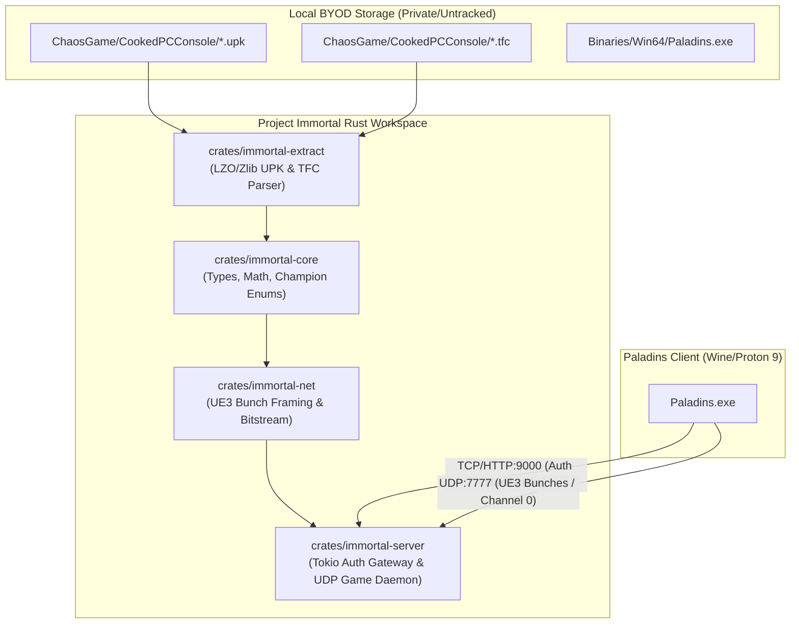

<!-- SPDX-License-Identifier: Apache-2.0 -->
<!-- Copyright (c) 2026 Project Immortal Contributors -->
<!-- Governed by: Cleanroom Preservation Standard & ICARO-42/b Ordinance -->

# Project Immortal 🔥🛡️
> *"I will not die, not yet, amigo!"* — Fernando, *Paladins: Champions of the Realm*

[](https://github.com/project-immortal/immortal/actions/workflows/ci.yml)
[](LICENSE-AGPL)
[](LICENSE-APACHE)
[](https://www.rust-lang.org)

**Project Immortal** is an open-source, cleanroom game preservation suite, server emulator, and community runtime for *Paladins: Champions of the Realm* (target engine: Unreal Engine 3 64-bit `ChaosGame`, target version: `8.1.5839.0`).

Our mission is to ensure that *Paladins* remains perpetually playable, archivable, and verifiable by the community, completely insulated from server shutdowns, unmaintained upstream dependencies, and proprietary lock-in.

---

## ⚖️ Legal Shield & Cleanroom Precedents

Project Immortal operates under strict cleanroom engineering standards supported by binding legal precedent:
- ***Sony Computer Entertainment, Inc. v. Connectix Corp.*** (203 F.3d 596, 9th Cir. 2000): Reverse engineering software to create a compatible, non-infringing product is protected fair use.
- ***Sega Enterprises Ltd. v. Accolade, Inc.*** (977 F.2d 1510, 9th Cir. 1992): Disassembly of copyrighted object code is fair use when necessary to understand functional and interoperability elements.
- ***Computer Associates Int'l, Inc. v. Altai, Inc.*** (982 F.2d 693, 2d Cir. 1992): Functional and efficiency elements of software are excluded from copyright protection.

### 🏛️ The Three Cleanroom Invariants

1. **The BYOD ("Bring Your Own Data") Principle (ADR-028)**:
   - This repository contains **ZERO** copyrighted game assets (no models, textures, audio banks, maps, or binaries).
   - All extraction occurs locally and privately on the user's personal machine using their legally purchased Steam game files via `immortal-extract`.
2. **Dirty Room / Clean Room Airlock Isolation**:
   - Binary disassembly, decompiler analysis (Ghidra, REA), and packet traces exist strictly in gitignored dirty-room sandboxes (`.rea/`, `dirty_room/`, `disassembly/`, `captures/`).
   - Cleanroom source code is authored exclusively by engineers implementing markdown specifications and protocol RFCs (`docs/specs/`).
3. **Typed Obligation Ledgers (`.agents/ledger/`)**:
   - Every protocol claim is backed by immutable cryptographic digests in `.agents/ledger/evidence_bundle.json` and formally tracked in `obligations.json`. Verified via `agyis verify`.

> [!IMPORTANT]
> **Nominative Fair Use & Trademark Disclaimer**:  
> *Paladins* and *Paladins: Champions of the Realm* are registered trademarks of Hi-Rez Studios and Evil Mojo Games. **Project Immortal is an independent, non-commercial game preservation project and is NOT affiliated with, endorsed by, sponsored by, or associated with Hi-Rez Studios or Evil Mojo Games in any manner.** All references to *Paladins* are made strictly under nominative fair use for compatibility, archival, and interoperability description.

---

## 📜 Split Licensing Architecture

To foster widespread archival tool adoption while preventing proprietary rogue servers from exploiting the preservation community, Project Immortal enforces a split licensing model:

| Crate / Component | License | Purpose & Rationale |
| :--- | :--- | :--- |
| [`crates/immortal-server`](crates/immortal-server) | **AGPL-3.0** | Network copyleft ensures any server host offering public multiplayer must release source improvements back to the community. |
| [`crates/immortal-net`](crates/immortal-net) | **AGPL-3.0** | Network copyleft covers UE3 bunch framing, protocol encoders, and auth gateway state machines. |
| [`crates/immortal-core`](crates/immortal-core) | **Apache-2.0 OR MIT** | Permissive dual license allows game constants, math primitives, and IDs to be used in any third-party tool or client. |
| [`crates/immortal-extract`](crates/immortal-extract) | **Apache-2.0 OR MIT** | Permissive dual license allows game preservationists, 3D modders, and external engines (Bevy, Godot, Blender) to freely reuse UPK/TFC extraction. |

---

## 🗺️ Macro Roadmap (G1–G6)

```
[G1: Asset Extraction] ──▶ [G2: MVP Auth & Range] ──▶ [G3: E2E Multiplayer]
          │                                                    │
          ▼                                                    ▼
[G6: Open-Source Client] ◀── [G5: Client Enhancements] ◀── [G4: Community Store]
```

- **[G1] Complete Asset Preservation Automation**:
  - High-throughput cleanroom extractor for CookedPCConsole Unreal Packages (`.upk`), Texture File Caches (`.tfc`), and FMOD audio banks.
  - Converts proprietary cooked structures to open standards (`.gltf`, `.dds`/`.png`, `.wav`).
- **[G2] MVP Server Protocol & Offline Range (Immediate Focus)**:
  - Auth gateway and UDP server implementation speaking the Unreal Engine 3 bit-packed bunch protocol.
  - Offline local simulation: boots client into `ShootingRange` sandbox with Fernando.
- **[G3] Baseline E2E Multiplayer Game**:
  - Full actor replication, health/shield tracking, ability cooldowns, and round state machines for Siege mode.
- **[G4] Community Store & Ecosystem Runtime**:
  - Decentralized local/community inventory server replacing proprietary microtransactions with unlocked champions, cosmetics, and card loadouts.
- **[G5] Modern Client Enhancements**:
  - Custom launcher, FOV unlockers, ultrawide fixes, and modern Vulkan translation shims.
- **[G6] Open-Source Client Replacement**:
  - Community-owned native client (Bevy/Rust or Godot 4) consuming G1 extracted assets and speaking G2/G3 networking.

---

## 🏗️ Architecture & Workspace Structure



- [`crates/immortal-core`](crates/immortal-core): Shared game types, champion IDs, math primitives, and constants.
- [`crates/immortal-extract`](crates/immortal-extract): Cleanroom UPK package parser and LZO/Zlib chunk decompressor.
- [`crates/immortal-net`](crates/immortal-net): UE3 bitstream parser, bunch serializer, and auth protocol state machines.
- [`crates/immortal-server`](crates/immortal-server): High-performance async game server daemon (Tokio).
- [`docs/specs`](docs/specs): Formal markdown cleanroom specifications.

---

## ⚡ Verification & Toolchain Commands

All contributions and builds must satisfy project-native hermetic verification:

```bash
# 🧪 Run full workspace test suite
cargo test

# 🩺 Code quality & linting checks
cargo clippy
cargo fmt --check

# 🛡️ Formally verify cleanroom specifications & typed obligation ledgers
agyis verify --spec
agyis verify
```

---

## 🤝 Contributing & Community Governance

Project Immortal welcomes community contributions! To preserve our legal standing and cleanroom airlock:
1. All commits must be signed off (`git commit -s`) under the [Developer Certificate of Origin (DCO)](CONTRIBUTING.md#developer-certificate-of-origin-dco).
2. Contributors must sign the [Cleanroom Contributor Agreement](CONTRIBUTING.md#cleanroom-contributor-attestation) affirming zero access to leaked or proprietary source code.
3. Follow the [Code of Conduct](CODE_OF_CONDUCT.md) and [Contributing Guide](CONTRIBUTING.md).

For vulnerability disclosure, please see [SECURITY.md](SECURITY.md).
