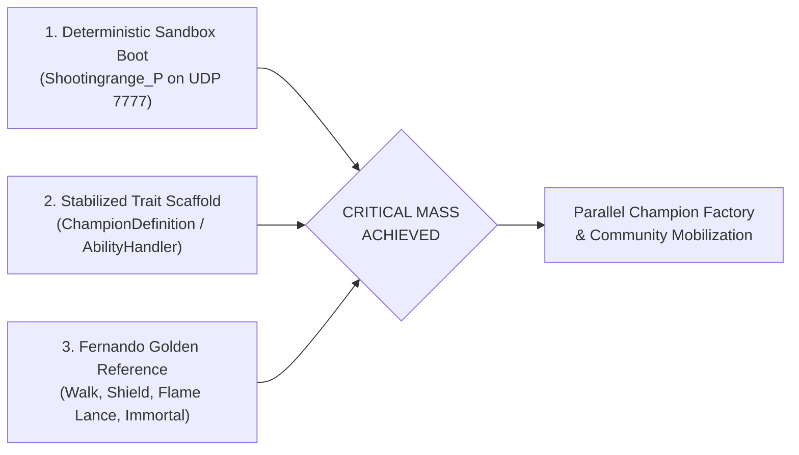

<!-- SPDX-License-Identifier: Apache-2.0 -->
<!-- Copyright (c) 2026 Arafat Zahan (@kuasha420) -->
<!-- Corporate Stewardship & Infrastructure: Purrfect Software Limited (PSL) -->
<!-- Governed by: ICARO-42/b Ordinance (Company-Supported Personal IP Framework) -->

# The Critical Mass Horizon: When & How We Fan Out 🎯🤝

> *"I will not die, not yet, amigo!"* — Fernando (*Project Immortal*)

**Document Standard**: `PSL-SPEC-2026-IMMORTAL-COMMUNITY-SCALE-001`  
**Operational Regime**: Track C (Cockpit Flight Direction / Community Scaling Framework)  
**Governing ADRs**: ADR-012 (Artifact-First Planning), ADR-014 (Product vs Project Bifurcation), ADR-015 (Clean-Room Verification), ADR-028 (Cleanroom Reconstruction)

---

## 1. Executive Vision: The Soul of the Project

*Paladins: Champions of the Realm* holds a unique place in the hearts of competitive gamers, game preservationists, and the engineering team at **Purrfect Software Limited (PSL)**. Having grown up playing the game together through youth and adulthood, the team shares a deep, personal commitment to ensuring that *Paladins* remains perpetually playable, decentralized, and free from proprietary vendor obsolescence.

A frequent and natural question is:  
**"When do we hit critical mass — the inflection point where we can involve the entire team and open community for massive, repetitive, parallel development?"**

This document formalizes that roadmap transition: defining the exact technical preconditions for critical mass, decomposing the parallel workstreams, and establishing the mobilization protocol.

---

## 2. The Two-Phase Trajectory of Game Preservation

In cleanroom emulator and server preservation projects (such as Dolphin, TrinityCore, or City of Heroes), development follows a two-phase trajectory:

```
[Phase 1: The Monolithic Pioneer Tunnel]  ──► [CRITICAL MASS] ──► [Phase 2: The Parallel Assembly Line]
 • 1-2 core architects                       "First Playable"       • 20+ PSL devs & community contributors
 • Reverse engineering opaque protocols      Fernando walks/shoots  • Modular Champion Factory (~59 heroes)
 • Unraveling crashes & bitstreams           in 3D sandbox          • Map extraction & Card databases
 • High risk of Brooks's Law bottleneck                             • Zero merge conflicts / High throughput
```

### Phase 1: The Monolithic Pioneer Tunnel (Milestones 0 – 3)
During initial reverse engineering, adding dozens of contributors creates friction (Brooks's Law). The team must first decode obscure binary wire codecs, uncompress MCTS tables, parse custom UE3 bitstream bunches, and isolate crash dumps. Context must stay razor-focused.

### The Inflection Point: Critical Mass (Milestone 4)
The inflection point occurs the exact moment the server achieves **"First Playable"** in the 3D Shooting Range sandbox. Once one complete champion (Fernando) walks, shoots, and triggers abilities on authoritative server actor channels without crashing, the architecture shifts from **deep protocol pioneering** into **wide, modular implementation**.

### Phase 2: The Parallel Assembly Line (Milestones 5 – 6)
With the foundation locked and verified, the codebase fractures into independent, modular units. Contributors can claim individual champions, cards, or maps and deliver them in parallel without merge conflicts or protocol breakage.

---

## 3. The Three Preconditions for Critical Mass

We formally declare Critical Mass and initiate wide team mobilization when all three preconditions are satisfied:



1. **Deterministic 3D Sandbox Boot**:
   Any engineer or community member can execute `cargo run` and launch the retail client directly into `Shootingrange_P` on UDP 7777 without crashes or manual memory patching.
2. **Stabilized Actor & Ability Trait Scaffold**:
   Cleanroom Rust traits are stabilized in `crates/immortal-server`:
   - `pub trait ChampionDefinition`
   - `pub trait AbilityHandler`
   - `pub trait ProjectileLogic`
   - `pub trait StatusEffect`
3. **Fernando as the Golden Reference**:
   Fernando (`TgPawn_Fernando`) serves as the verified baseline: walking, aiming, firing his primary weapon (Flame Lance), deploying his directional barrier (Shield), launching Fireball, charging forward, and casting his ultimate (Immortal).

---

## 4. The Four Massive Repetitive Parallel Tracks

Once Critical Mass is unlocked, work divides cleanly across four independent, high-throughput engineering tracks:

### Track 1: The Modular Champion Factory ⚔️
*Paladins* features **~59 Champions** spanning four distinct roles: Front Line, Damage, Support, and Flank.

Each champion is encapsulated as an isolated submodule under `crates/immortal-champions/`:
```
crates/immortal-champions/
├── fernando/     <-- Golden reference implementation
├── cassie/       <-- Contributor A (Bow, Dodge Roll, Disengage, Blast Shot, Scout)
├── androxus/     <-- Contributor B (Revolver, Nether Step, Defiance, Accursed Arm)
├── drogoz/       <-- Contributor C (Rocket Launcher, Fire Spit, Salvo, Thrust, Dragon Punch)
├── evie/         <-- Contributor D (Ice Staff, Blink, Ice Block, Soar, Ice Storm)
├── mal_damba/    <-- Contributor E (Spit, Mending Spirits, Gourd, Slither, Dread Serpent)
└── viktor/       <-- Contributor F (Assault Rifle, Iron Sights, Frag Grenade, Hustle, Barrage)
```

Each champion contributor receives:
- Champion UPK asset mappings extracted via `immortal-extract`.
- A hermetic test suite asserting damage numbers, cooldown durations, projectile velocities, and modifier scaling.
- A standardized PR gate that compiles and tests in under 1 second.

### Track 2: The Item Shop, Talents & Card Data Engine 🃏
*Paladins* features a rich customization layer: 16 cards per champion, 3 talents per champion, and 16 universal in-match burn items (Cauterize, Wrecker, Haven, Nimble, Chronos, etc.).

This track is pure data modeling (JSON/TOML) paired with deterministic modifier logic:
- Defining ability cooldown reduction percentages.
- Scaling crowd control reduction (Resilience) and shield penetration (Wrecker).
- Authoring talent overrides (e.g. Fernando's *Aegis* granting infinite shield duration with cooldown regeneration).

### Track 3: Map Geometry & Collision Nav-Meshes 🗺️
Using `immortal-extract`, engineers process cooked UPKs across all classic Siege and Payload maps:
- *Jaguar Falls*, *Serpent Beach*, *Frog Isle*, *Stone Keep*, *Splitstone Quarry*.
- Extracting capture zone bounding spheres, objective radii, payload spline waypoints, spawn room airlocks, and jump pad impulse vectors into structured TOML world definitions.

### Track 4: Synthetic Conformance & Adversarial Fuzzing 🧪
Developing property-based tests and packet fuzzing batteries:
- Simulating out-of-order UDP bunch packets to prove the server never panics or deadlocks.
- Simulating extreme network latency (150ms–300ms) to verify client prediction reconciliation.
- Validating projectile hit registration under high concurrent player loads.

---

## 5. Team Mobilization & Community Protocol

When Milestone 4 concludes and Critical Mass is unlocked:

1. **The "Claim a Champion" Issue Board**:
   - A dedicated GitHub Projects board will open with pre-scaffolded issue templates for all 59 champions.
   - Each template includes the champion's class ID, primary device hashes, ability animation names, and base stats.
   - Engineers self-assign by claiming the champion issue (e.g. `[Champion]: Implement Drogoz (ID: 2246)`).
2. **Standardized Champion Integration Guide**:
   - Every contributor follows [`docs/dev/champion_guide.md`](champion_guide.md) to author, extract, wire, and test their champion hermetically.
3. **PSL Immortal Hackathons & Community Playtests**:
   - Internal PSL hackathons where pairs of engineers spend dedicated pairing sessions building and testing champion kits in local shooting range duels.
   - Regular community playtest milestones running on local Docker instances of `immortal-server`.

---

## 6. Current Progress Toward Critical Mass

| Milestone | Description | Status | Distance to Critical Mass |
| :---: | :--- | :---: | :--- |
| **M0** | Cleanroom Tooling & Binary Intelligence | **Done** | Complete |
| **M1** | MCTS Auth & 3D Main Menu Unfreeze | **Done** | Complete |
| **M2** | Map Instance Orchestration & Sandbox Travel | **Active** | 1 Milestone away |
| **M3** | UDP 7777 Protocol Handshake Driver | **In Progress** | Implemented & Integrating |
| **M4** | **Authoritative Simulation & Fernando (Critical Mass)** | **Scheduled** | **CRITICAL MASS GATE** |

We are currently bridging Milestone 1 to Milestone 2. Once the live client boots into `Shootingrange_P` and Fernando materializes, the gateway opens for the entire PSL team and community to build together.
