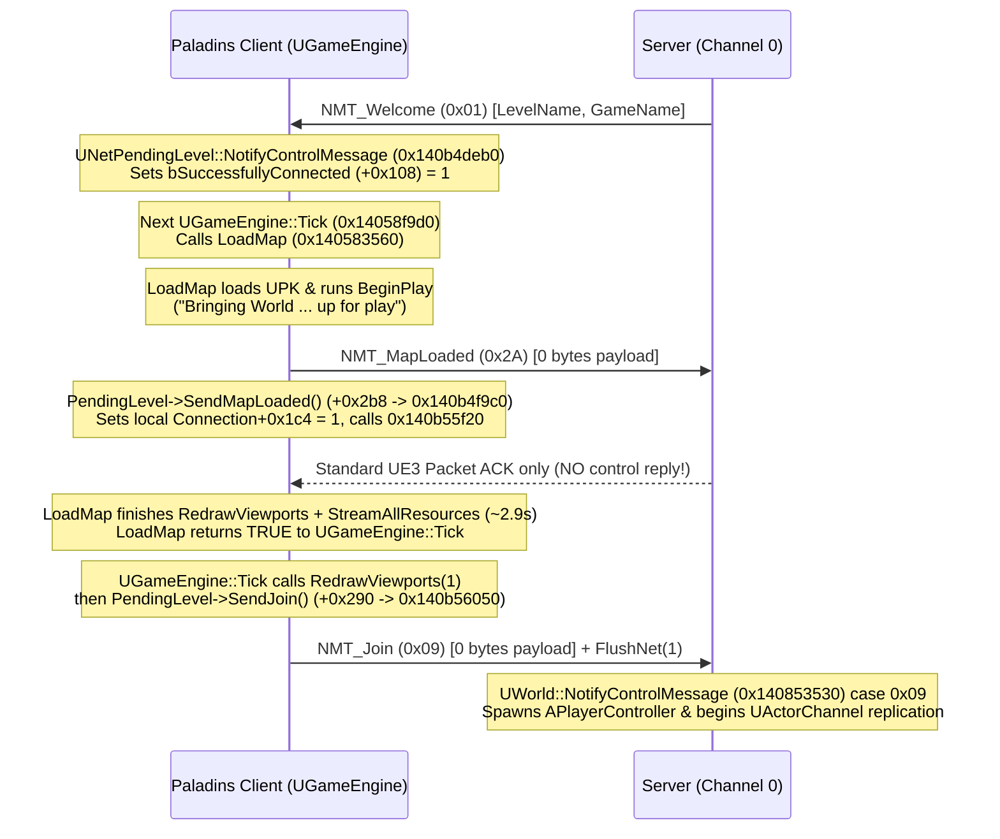

<!-- SPDX-License-Identifier: Apache-2.0 -->
<!-- Copyright (c) 2026 Arafat Zahan (@kuasha420) -->
<!-- Corporate Stewardship & Infrastructure: Purrfect Software Limited (PSL) -->
<!-- Governed by: ICARO-42/b Ordinance (Company-Supported Personal IP Framework) -->

# Flight 036 Static REA & Cleanroom Decoder Reconnaissance

> **Target Artifact**: `ShippingPC-ChaosGame.exe` (Paladins `8.1.5839.0`, PE32+ x86_64)  
> **Artifact SHA-256**: `0c51d381dfe9ecbc1f571ab36603478626375704f4e4e40482524a1adafd6f75`  
> **Analysis Provider**: REA MCP `ghidra` (Ghidra 12.2, direct-mount pre-analyzed `PaladinsProject.gpr`, `-noanalysis -readOnly`, PSL-INV-009)  
> **Cleanroom Boundary (`PSL-INV-007`)**: This synthesis contains zero raw decompiled C/C++ listings and zero disassembly dumps. All claims are derived behavioral specifications bound to immutable REA Evidence IDs and virtual addresses.

---

## Executive Findings Summary

1. **Opcode `0x2A` Solved (`NMT_MapLoaded`)**:
   - Exact control message identity: **`NMT_MapLoaded`** (`0x2A`, string `"MapLoaded"` at `0x142782138`).
   - Exact wire layout: **1 byte total (`[0x2A]`, 0 bytes of payload)**.
   - Exact sequencing: `UGameEngine::LoadMap` (`0x140583560`) emits `NMT_MapLoaded` immediately after `BeginPlay` (`Bringing World ... up for play`), **before** `RedrawViewports` and `StreamAllResources`.
   - **Zero server response is required to unblock `NMT_Join (0x09)`**. On the server, `0x2A` simply sets `Connection->bMapLoaded = 1` (offset `+0x1c4`) and sends no control reply. Immediately after `LoadMap` finishes `StreamAllResources` and returns `TRUE`, `UGameEngine::Tick` (`0x14058f9d0`) calls `GPendingLevel->SendJoin()` (`0x140b56050`), transmitting `NMT_Join (0x09)` + `FlushNet(1)`.
2. **`UNK-UDP-003` Resolved Statically (`NMT_Uses`, `NMT_UsesOpt`, `NMT_UsesOptEx`, `NMT_MarshalPackage`, and Channel 1 `UMarshalChannel`)**:
   - Exact extended control message identities and wire layouts recovered for `0x07` (`NMT_Uses`), `0x27` (`NMT_MarshalPackage`), `0x29` (`NMT_PlayTime`), `0x2A` (`NMT_MapLoaded`), `0x2B` (`NMT_TimeLapse`), `0x2C` (`NMT_UsesOpt`), and `0x2D` (`NMT_UsesOptEx`).
   - **Channel 1 (`CHTYPE_Marshal = 5`, `ChIndex = 1`) is NOT required before or during map join.** Both client and server pre-create `Channels[0]` (`Control`) and `Channels[1]` (`Marshal`) locally, but `UPComNetConn::Tick` (`0x140d52350`) only transmits `0x27` (`NMT_MarshalPackage`) chunks after `Connection->Actor` (`APlayerController`) is non-null. Crucially, `UWorld::NotifyAcceptingChannel` (`0x140853100`) on the **client** refuses every server-initiated channel except `CHTYPE_Actor = 2` — the server must **never** send `bOpen=1` on Channel 1.
3. **`UNK-UDP-004` Static Blueprint (`UActorChannel` Framing & Object Serialization)**:
   - Confirmed bit-for-bit that `UNetConnection::ReceivedPacket` (`0x140b36500`) has **no `bPartial` bit** in the bunch header; our existing `crates/immortal-net/src/bunch.rs::Ue3Packet::decode` already matches the wire bunch framing 100%.
   - Documented exact `bOpen = 1` actor creation header (`ObjectRef` + conditional quantized `Location` + conditional byte-packed `Rotation` + conditional `u8 NetPlayerIndex` for `APlayerController` -> `FClassNetCache` `RepIndex` property/RPC loop) for both `UPackageMapLevel` (default, `GUseSeekFreePackageMap == 0`) and `UPackageMapSeekFree` (`-SEEKFREEPACKAGEMAP`).
4. **Existing Cleanroom Decoder (`crates/immortal-net/`) Ready for `CAP-01`**:
   - `Ue3Packet::decode` / `Ue3Packet::decode_with_max_bits` + `BitReader` are immediately usable for a scratch `CAP-01` pcapng decoder; adding `ControlMessage` variants for `0x07`, `0x08`, `0x27`, `0x29`, `0x2A`, `0x2B`, `0x2C`, `0x2D` and `BitReader` helpers for compressed vector/rotator/object-ref unlocks full packet+bunch+control+actor-header inspection.

---

## 1. Objective 1 — Control Channel Opcode `0x2A` (`NMT_MapLoaded`)

### 1.1 Identity, Evidence & Wire Specification

| Property | Verified Specification | Evidence / VA |
| :--- | :--- | :--- |
| **Opcode** | `0x2A` (`42` decimal) | `0x140b34be0` (`ev_6a824879...`) |
| **Engine Name** | `NMT_MapLoaded` (`L"MapLoaded"`) | String `0x142782138` (`ev_32668e97...`); table slot `FNetControlMessageInfo::Names[0x2A]` at `0x143d27be0` (`ev_0a55ab14...`), initialized by `0x1423c8580` |
| **Direction** | Client → Server (Channel 0, `CHTYPE_Control = 1`, `bReliable = 1`) | Sender `0x140b55f20` (`ev_009ff605...`) |
| **Wire Payload** | **0 bytes** (1 byte total in bunch: `[0x2A]`, 8 bits) | `0x140b55f20` writes only 1 byte (`0x2A`) to `FOutBunch(Channels[0], bClose=0)` and sends with `bMerge=1` |
| **Server Receiver Effect** | Sets `*(u32*)(Connection + 0x1c4) = 1` (`bMapLoaded = TRUE`). Consumes 0 trailing bytes. **Sends NO response.** | `UControlChannel::ReceivedBunch` `0x140b34be0` (`ev_6a824879...`) `case 0x2a`; `UWorld::NotifyControlMessage` `0x140853530` (`ev_55a49318...`) `case '*'` |

### 1.2 Exact Post-`NMT_Welcome` Client Lifecycle (Why `0x2A` Fires Before `NMT_Join`)

**Root Cause of Flight 035 Stall Before `NMT_Join`**:
1. `crates/immortal-net/src/bunch.rs::ControlMessage::decode_from_reader` rejected opcode `0x2A` as `Unknown Control Message opcode 0x2a`, dropping the bunch (and preventing clean ACK/state progression if any sibling message was packed).
2. `flight.py` terminated the client `0.15s` after `StreamAllResources` completed — right in the tiny window between `LoadMap` returning `TRUE` and `UGameEngine::Tick` invoking `RedrawViewports(1)` + `GPendingLevel->SendJoin()` (`0x140b56050`, `ev_ad78dea1...`).
3. **Server Fix Spec**: Add `NMT_MAP_LOADED = 0x2A` (`ControlMessage::MapLoaded`, 0-byte payload), acknowledge the packet normally, record `client_map_loaded = true` in `ControlChannelHandshake`, emit **zero** control replies, and allow the client `>= 5s` post-`StreamAllResources` to emit `NMT_Join (0x09)`.

---

## 2. Objective 2 — `UNK-UDP-003`: Extended Control Opcodes (`0x07`, `0x27`, `0x29`–`0x2D`) & Channel 1 (`UMarshalChannel`)

### 2.1 Complete Recovered Control Channel Opcode Table (`0x27`–`0x2D` + `0x07`)

Verified from `UControlChannel::ReceivedBunch` (`0x140b34be0`, `ev_6a824879...`), `FNetControlMessageInfo::Names` (`0x143d27a90..0x143d27bf8`), static initializers (`0x1423c8580..0x1423c8c60`), UTF-16LE strings (`0x142782050..0x142782268`, `ev_32668e97...`), and individual serializers/deserializers:

| Opcode | Name (`FNetControlMessageInfo::Names`) | Bitstream Wire Layout (LSB-first after 1-byte opcode) | Evidence / VAs |
| :---: | :--- | :--- | :--- |
| **`0x07`** | `NMT_Uses` | `FGuid` (`4 × u32`), `FString PackageName`, `FString Extension`, `FString URL`, `u32 PackageFlags`, `u32 RemoteGeneration`, `FString LocalPackageName` (stored as `FName`), `u8 bLoadingFromCache` | `0x140b26ec0` (`ev_f8187aa2...`), `0x140b31b70` (`ev_18557ec4...`) |
| **`0x27`** | `NMT_MarshalPackage` | Conditional header + chunk: **if** start of new reassembly (`BytesRemaining == 0`), `SerializeInt(TotalSize, 0x80000)` (19-bit unsigned; rejected if `> 0x800000`), **always** `SerializeInt(ChunkSize, 0x200)` (9-bit unsigned; sender caps chunk `<= 0x1cc = 460` bytes), followed by `ChunkSize` raw bytes of serialized `CMarshal` stream. | `0x140d9be80` (`ev_50e6521d...`), `0x140d50310` (`ev_d2804a4a...`), `0x140d52660` (`ev_8f1bb489...`), `0x140d52410` (`ev_08be373f...`) |
| **`0x29`** | `NMT_PlayTime` | `u32` (4 bytes LE) | `0x1427820b8`, `0x140b27450`, `0x140b55da0`, `0x140853530` `case ')'` |
| **`0x2A`** | `NMT_MapLoaded` | **0 bytes** | `0x142782138`, `0x140b55f20` (`ev_009ff605...`) |
| **`0x2B`** | `NMT_TimeLapse` | `u32`, `u32` (8 bytes LE) | `0x1427821e8`, `0x140b26cc0`, `0x140444a90` |
| **`0x2C`** | `NMT_UsesOpt` | `FGuid` (`4 × u32`), `FString PackageName`, `u32 PackageFlags`, `i32 CachedExtIndex` (indexes into `Connection + 0xb098` string table populated by `0x2D`; `-1` = none) | `0x142782258`, `0x140b27810` (`ev_0c269451...`), `0x140b3aae0` (`ev_aa7bff6a...`), `0x140b31b70` (`ev_18557ec4...`) |
| **`0x2D`** | `NMT_UsesOptEx` | `FGuid` (`4 × u32`), `FString PackageName`, `u32 PackageFlags`, `i32 GenOrFlags`, `FString ExtensionOrParent` (appended to `Connection + 0xb098` cache table for subsequent `NMT_UsesOpt` packets) | `0x142782268`, `0x140b27940` (`ev_044215eb...`), `0x140b3ade0` (`ev_6bb4b892...`), `0x140b31b70` (`ev_18557ec4...`) |

**Key `NMT_Uses` / `NMT_UsesOpt` / `NMT_UsesOptEx` Note**:
- Both `UNetPendingLevel::NotifyControlMessage` (`0x140b4deb0`, `ev_16b7bab4...`) and `UWorld::NotifyControlMessage` (`0x140853530`, `ev_55a49318...`) route `0x07`, `0x2C`, and `0x2D` identically through `FUN_140b31b70` (`ev_18557ec4...`), which builds an `FPackageInfo` entry and registers it into `Connection->PackageMap` (`PackageMap->AddPackageInfo` at `vtable + 0x2c0`).
- During `UNetPendingLevel` (`0x140b4deb0`), if a package is found locally on disk, the client responds with `NMT_Have (0x08)` (`FGuid` + `i32 Generation`, sent via `0x14058adb0`). In Flight 035, **zero** `NMT_Uses` messages were sent before `NMT_Welcome` and the client still loaded `Shootingrange_P` cleanly — however, for `UPackageMapLevel` (default `GUseSeekFreePackageMap == 0`), `NMT_Uses`/`0x2C`/`0x2D` populate the shared package index table required for `SerializeObject` indices! (See §3.2 and §5 Residual Unknowns.)

### 2.2 Channel 1 (`UMarshalChannel`, `CHTYPE_Marshal = 5`) Architecture & Pre-Join Requirement

| Question | Verified Finding | Evidence / VAs |
| :--- | :--- | :--- |
| **Channel Assignment** | `UNetConnection::CreateChannel` (`0x140b25e90`) auto-assigns: `CHTYPE_Control (1) -> ChIndex 0`, `CHTYPE_Marshal (5) -> ChIndex 1`, `CHTYPE_Voice (4) -> ChIndex 2`, `CHTYPE_Actor (2) / CHTYPE_File (3) -> ChIndex >= 3`. | `ev_ef716873...` (`0x140b25e90`) |
| **Local Pre-Creation** | Both client (`UTcpNetDriver::InitConnect` `0x140bba7e0`) and server (`UTcpNetDriver` accept path `0x140bbb580`) locally allocate `Channels[0]` (`CHTYPE_Control = 1`) and `Channels[1]` (`CHTYPE_Marshal = 5`) immediately upon connection creation. | `ev_2709e3c0...` (`0x140bba7e0`), `ev_274fbf42...` (`0x140bbb580`) |
| **Client Acceptance Policy** | `UWorld::NotifyAcceptingChannel` (`0x140853100`) on **Client** rejects **all** server-opened channels where `ChType != 2 (CHTYPE_Actor)` (`"Client refusing unwanted channel of type %i"`). On **Server**, it accepts `Control (Ch0)`, `Marshal (5)`, and `File (3)`. | `ev_00791600...` (`0x140853100`) |
| **Wire Routing (`0x27`)** | `UPComNetConn::Tick` (`0x140d52350`) checks `bUseMarshalChannel` (`Connection + 0xb14c`): if `0`, sends `0x27` over **Channel 0** (`0x140d52660`); if `1`, sends `0x27` over **Channel 1** (`0x140d52410`, queued & bandwidth-throttled via `UMarshalChannel::Tick` `0x140b40800` -> `0x140b330e0`). **Both** receivers (`UControlChannel::ReceivedBunch` `0x140b34be0` and `UMarshalChannel::ReceivedBunch` `0x140b35cf0`) delegate `0x27` to the identical `PCOMReceivedMarshal` (`0x140d9be80` -> `0x140d50310`). | `ev_b8c07067...`, `ev_8f1bb489...`, `ev_08be373f...`, `ev_e9f1383c...`, `ev_69524856...` |
| **Required Before/During Map Join?** | **NO.** Both `0x140d52660` (Ch 0) and `0x140d52410` (Ch 1) explicitly gate on `Connection->Actor != NULL` (`Connection + 0x68`). No `0x27` marshal traffic or Channel 1 traffic is emitted until after `NMT_Join` spawns `APlayerController`. **Trap**: Server must NEVER send `bOpen=1` on `ChIndex=1, ChType=5` to client (client will refuse it). | `ev_8f1bb489...`, `ev_08be373f...`, `ev_00791600...` |

---

## 3. Objective 3 — `UNK-UDP-004`: `UActorChannel` Wire Framing & Minimum World Actors

### 3.1 Packet & Bunch Header Framing Verification

Verified from `UNetConnection::ReceivedPacket` (`0x140b36500`, `ev_f2751ca2...`):
- Outer `UPComNetConn` prefix: **6 bytes** (`PCOM_PREFIX_LEN = 6`), stripped before UE3 stop-bit decoding.
- UE3 Datagram body (LSB-first, terminated by trailing `1` stop bit):
  1. `InPacketId`: `SerializeInt(0x4000)` (14 bits)
  2. Repeated until bit-stream end:
     - `IsAck` (1 bit): if `1`, `AckPacketId = SerializeInt(0x4000)` (14 bits).
     - If `0` (Bunch header — **NO `bPartial` bit exists in Paladins UE3**):
       1. `bControl` (1 bit); if `1`, `bOpen` (1 bit) + `bClose` (1 bit)
       2. `bReliable` (1 bit)
       3. `ChIndex`: `SerializeInt(0x800)` (11 bits; `>= 3` for `CHTYPE_Actor`)
       4. If `bReliable`: `ChSequence`: `SerializeInt(0x400)` (10 bits, 1-based)
       5. If `bReliable || bOpen`: `ChType`: `SerializeInt(8)` (3 bits; `2` = `CHTYPE_Actor`)
       6. `BunchDataBits`: `SerializeInt(MaxPacket * 8)` (`4608` standard UDP; `3968` `?exudp>=1`)
       7. `BunchData`: `BunchDataBits` raw LSB-first bits.

### 3.2 `UActorChannel` Opening Bunch (`bOpen = 1`, `ChType = 2`, `ChIndex >= 3`) Payload Layout

Verified symmetrically across `UActorChannel::ReceivedBunch` (`0x140b33b30`, `ev_a5450b0f...`) and `UActorChannel::ReplicateActor` (`0x140b379f0`, `ev_7ef9153a...`):

| Stage | Condition | Exact Bitstream Layout | Evidence / VAs |
| :--- | :--- | :--- | :--- |
| **1. Actor/Archetype Reference** | Always on `bOpen = 1` when `Channel->Actor == NULL` | `FInBunch::operator<<(UObject*&)` (`0x140b20160`) -> `PackageMap->SerializeObject`: • **`UPackageMapLevel` (default, `GUseSeekFreePackageMap == 0`)**: 1 bit `bDynamicActor` (`0` = `SerializeInt(StaticObjIndex, 0x80000000)` resolving static level actor or class/archetype; `1` = `SerializeInt(ChIndex, 0x800)` resolving existing channel actor). • **`UPackageMapSeekFree` (`-SEEKFREEPACKAGEMAP`)**: `i32` LE (`0` = NULL; `-1` followed by `FString ObjectPathName` resolved via `StaticFindObject`; `1..2047` = existing channel actor `ChIndex`). | `0x140b20160` (`ev_6ad214a6...`), `0x140b569e0` (`ev_5bedef0f...`), `0x140b56e60` (`ev_c509267a...`) |
| **2. Dynamic Actor Spawn Location** | Iff resolved object has `RF_ArchetypeObject \| RF_ClassDefaultObject` (`*(u32*)(obj+0x10) & 0x600 != 0`, i.e., dynamically spawned actor) | `SerializeCompressedVector` (`0x1401a1ee0`): 1. `Bits`: `SerializeInt(Bits, 20)` (range `1..=19`, `Bias = 1 << Bits`, `Max = 1 << (Bits + 1)`). 2. `X`: `SerializeInt(round(x) + Bias, Max)`. 3. `Y`: `SerializeInt(round(y) + Bias, Max)`. 4. `Z`: `SerializeInt(round(z) + Bias, Max)`. | `0x1401a1ee0` (`ev_d0b71e1f...`), `0x140d44eb0` (`ev_c5a8940a...`) |
| **3. Dynamic Actor Spawn Rotation** | Iff dynamic actor **AND** `Actor->bNetInitialRotation` (`(*(u32*)(archetype+0xe8) >> 5) & 1 != 0`) | `SerializeCompressedRotator` (`0x1401a1dc0`): For each of **Pitch, Yaw, Roll** in order: 1 bit `bNonZero`; if `1`, 1 byte `u8` (`rotator_component >> 8`, restored as `(u32)byte << 8`). | `0x1401a1dc0` (`ev_7c9d5c7c...`), `0x140d44eb0` (`ev_c5a8940a...`) |
| **4. Channel Actor Binding** | Always after spawn/lookup | Calls `UActorChannel::SetChannelActor(Actor)` (`0x140b3d430`). | `0x140b33b30` (`ev_a5450b0f...`) |
| **5. PlayerController Binding Byte** | Iff `Actor->GetAPlayerController() != NULL` (`vtable + 0x6f0 != 0`) | **1 byte (`u8 NetPlayerIndex`)**: • `0` -> primary local player; calls `ServerConnection->HandleClientPlayer(PC)` (`vtable + 0x2d8`), attaching the local `ULocalPlayer` viewport/camera! • `> 0` -> split-screen child connection index (`NetPlayerIndex - 1`). | `0x140b33b30` (`ev_a5450b0f...`), `0x140b379f0` (`ev_7ef9153a...`) |
| **6. Property & RPC Stream** | Loop until bit-reader end (`Ar.IsError()` / `AtEnd`) | Reads `RepIndex = SerializeInt(MaxIndex)` where `MaxIndex = ClassNetCache->FieldsBase + ClassNetCache->FieldsNum` (`*(i32*)(cache+0x10) + *(i32*)(cache+0x30)`): • **Replicated Property (`UProperty`, `ClassFlags & 0x8000`)**: if `ArrayDim > 1`, reads `u8 ArrayIndex`; then `Property->NetSerializeItem(Bunch, PackageMap, Dest)` (`vtable + 0x2c0`); triggers `PostNetReceive` (`+0x3e0`) + `ReplicatedEvent` (`CPF_RepNotify`) + `PostNetReceiveLocation` (`+0x3f8`). • **Replicated RPC (`UFunction`, `ClassFlags & 0x80000`)**: iterates `CPF_Parm` properties (non-mandatory params guarded by 1-bit `bHasParam`), then invokes `ProcessEvent`. | `0x140b33b30` (`ev_a5450b0f...`) |

> **Important Note on `GUseSeekFreePackageMap` (`0x1438661bc`)**: Static `.data` initial value is `0` (`ev_02090c73...`), overridden to `1` only via `-SEEKFREEPACKAGEMAP` (`0x140d18913`, `ev_e2757648...`). Thus retail Paladins (`-seekfreeloadingPCConsole` without `-SEEKFREEPACKAGEMAP`) uses `UPackageMapLevel` (requiring `NMT_Uses`/`0x2C`/`0x2D` package indexing), whereas local dev testing with `-SEEKFREEPACKAGEMAP` (if accepted by `ShippingPC-ChaosGame.exe`) allows direct string-path `ObjectRef` (`-1 + FString`) without building a full UPK NetIndex table! `CAP-01` will confirm the exact retail mode immediately.

### 3.3 Minimum Replicated Actors Required to Render the 3D Shooting Range

Based on `UActorChannel::ReceivedBunch` (`0x140b33b30`) and `UWorld::NotifyControlMessage` `NMT_Join` (`0x140853530` `case '\t'`):
1. **`ATgPlayerController`** (first actor channel, e.g., `ChIndex = 3`, `NetPlayerIndex = 0`): triggers `ServerConnection->HandleClientPlayer(PC)` (`vtable + 0x2d8`), binds `ULocalPlayer` viewport camera, and unblocks HUD/input.
2. **`ATgRepInfo_Game`** (`GameReplicationInfo` subclass for `Shootingrange_P`, e.g., `ChIndex = 4`): populates `WorldInfo->GRI` (match state, game class, team lists) so client HUD & camera ticks do not stall waiting for GRI.
3. **`ATgPlayerReplicationInfo`** (e.g., `ChIndex = 5`, referenced by `PC->PlayerReplicationInfo`): binds player name, `TeamInfo`, and champion/loadout metadata.
4. **`ATgPawn_Fernando`** (e.g., `ChIndex = 6`, referenced by `PC->Pawn` / `AcknowledgedPawn` + `ClientRestart` RPC): spawns Fernando at the Shooting Range spawn point, binds first-person camera eye height and Flame Lance (`DeviceId = 10774`), enabling live 3D rendering and movement.

---

## 4. Objective 4 — Existing `crates/immortal-net/` Bitstream & Decoder API Audit

### 4.1 Ready-to-Use Cleanroom Decoder Primitives

| Module | Exported Types / Functions | Status for `CAP-01` Scratch Pcap Decoder |
| :--- | :--- | :--- |
| `crates/immortal-net/src/bitstream.rs` | `strip_stop_bit(&[u8]) -> Result<usize>`, `BitReader::new(data, num_bits)`, `read_bit`, `read_int(max)`, `read_bits`, `read_bytes`, `read_u8`/`u16`/`u32`/`i32`/`u64`, `read_fstring`, `BitWriter`, `ue3_str_crc`, `ue3_handshake_crc` | **100% bit-exact** for UE3 LSB-first transport, non-power-of-two `SerializeInt(4608)`, and ASCII/UTF-16 `FString`. |
| `crates/immortal-net/src/bunch.rs` | `Ue3Packet::decode(&[u8])`, `Ue3Packet::decode_with_max_bits(&[u8], usize)`, `Bunch::decode_bits(&mut BitReader, max_bits)`, `BunchHeader`, `BunchFlags`, `Ue3ChannelType` (`Control=1`, `Actor=2`, `File=3`, `Voice=4`, `Marshal=5`), `ControlMessage::decode_all(&[u8], num_bits)`, `ControlChannelHandshake`, `HandshakePhase` | **Packet & Bunch headers are 100% bit-exact** (verified against `0x140b36500` — zero `bPartial` bits!). Supports both `DEFAULT_MAX_PACKET_BITS = 4608` and `EXUDP_MAX_PACKET_BITS = 3968`. |
| `crates/immortal-net/src/udp_framing.rs` | `parse_cpack_udp`, `HelloSend`, `PingSend`, `sha256`, `hmac_sha256` | Legacy CPackUdp transport (note: live UE3 `PComNetConn` uses 6-byte outer prefix + `Ue3Packet`). |
| `crates/immortal-server/src/replication.rs` | `ReplicationSession`, `PlayerControllerActor`, `PawnActor`, `Vector3`, `Rotator` | Placeholder byte-aligned custom sub-opcodes (`0x01..0x04`); **must be replaced** with authentic bit-packed `UActorChannel` `bOpen` header + `FClassNetCache` replication once `CAP-01` validates `PackageMap` mode and `RepIndex` layouts. |

### 4.2 Exact Additions Needed for `CAP-01` Decoding & Flight 036 Unblock

1. **In `crates/immortal-net/src/bunch.rs` (`ControlMessage`)**:
   - Add constants & enum variants for `NMT_USES (0x07)`, `NMT_HAVE (0x08)`, `NMT_MARSHAL_PACKAGE (0x27)`, `NMT_PLAY_TIME (0x29)`, **`NMT_MAP_LOADED (0x2A)`** (0 bytes), `NMT_TIME_LAPSE (0x2B)`, `NMT_USES_OPT (0x2C)`, and `NMT_USES_OPT_EX (0x2D)`.
   - In `ControlChannelHandshake::handle_control_message`, handle `ControlMessage::MapLoaded` by recording `client_map_loaded = true` and returning `Ok(Vec::new())` (zero server replies).
   - For a `CAP-01` scratch pcap decoder (Rust bin/example or Python script mirroring `bitstream.rs` + `bunch.rs`), also decode stateful `NMT_MarshalPackage (0x27)` chunk headers (tracking `bytes_remaining == 0` per direction/channel) and dump `CHTYPE_Actor (2)` `bOpen=1` headers (`ObjectRef`, compressed `Location`/`Rotation`, `NetPlayerIndex`, and remaining property/RPC bit payload).
2. **In `crates/immortal-net/src/bitstream.rs` (`BitReader` / `BitWriter`)**:
   - Add `read_compressed_vector` / `write_compressed_vector` (`0x1401a1ee0`), `read_compressed_rotator` / `write_compressed_rotator` (`0x1401a1dc0`), and `read_package_map_object_ref` (`UPackageMapLevel` & `UPackageMapSeekFree` modes).

---

## 5. Residual Unknowns Awaiting `CAP-01` Live Retail Pcap Confirmation

| Unknown ID | Question / Ambiguity | How `CAP-01` Pcap Resolves It |
| :--- | :--- | :--- |
| **`RES-036-01`** | Does retail Paladins (`8.1.5839.0`) run `UPackageMapLevel` (sending `NMT_Uses`/`0x2C`/`0x2D` before `NMT_Welcome`) or `UPackageMapSeekFree` (`-SEEKFREEPACKAGEMAP`) on dedicated match servers? | Inspect Channel 0 bunches between `NMT_Login (0x05)` and `NMT_Welcome (0x01)` (presence of `0x07`/`0x2C`/`0x2D` + client `0x08 NMT_Have`), and inspect the first `bOpen=1` `CHTYPE_Actor` bunch header (`1-bit + SerializeInt` vs `i32 -1 + FString`). |
| **`RES-036-02`** | Is `UPComNetConn::bUseMarshalChannel` (`Connection + 0xb14c`) `0` (Channel 0 `0x27`) or `1` (Channel 1 `UMarshalChannel` `0x27`) on live retail dedicated servers, and what `CMarshal` function IDs traverse `0x27` post-join? | Check whether `CAP-01` emits `ChIndex=1, ChType=5` bunches or `ChIndex=0` opcode `0x27` bunches after `NMT_Join (0x09)`, and reassemble the `CMarshal` stream via `0x140d50310` framing. |
| **`RES-036-03`** | Exact `FClassNetCache` `RepIndex` numbers and `MaxIndex` bounds for `ATgPlayerController`, `ATgRepInfo_Game`, `ATgPlayerReplicationInfo`, and `ATgPawn_Fernando` on `8.1.5839.0` (needed to encode `Pawn`, `PlayerReplicationInfo`, `GRI`, `Team`, `Location`, and `ClientRestart` RPC bit-accurately). | Decode the initial `bOpen=1` Actor Channel bunches in `CAP-01` (Bot Siege, Fernando) to observe exact opening actor sequence, archetype indices/paths, and initial `RepIndex` property/RPC payloads. |
| **`RES-036-04`** | Exact `MaxPacket` / `MaxPacketBits` (`4608` vs `3968` `?exudp>=1`) and 6-byte `PComNetConn` outer prefix format on live retail cloud match servers. | Inspect first 5 server-to-client and client-to-server UDP datagrams in `CAP-01` using `Ue3Packet::decode` (`4608`) and `Ue3Packet::decode_with_max_bits(..., 3968)`. |
