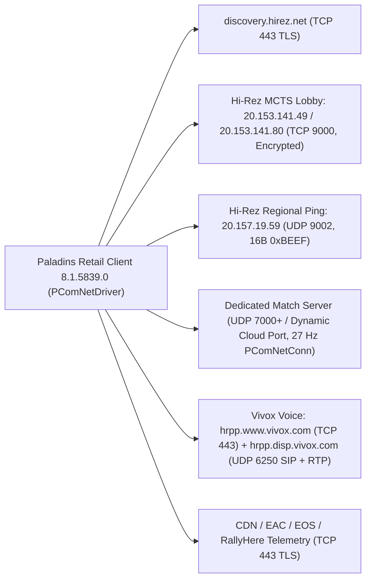

<!-- SPDX-License-Identifier: Apache-2.0 -->
<!-- Copyright (c) 2026 Arafat Zahan (@kuasha420) -->
<!-- Corporate Stewardship & Infrastructure: Purrfect Software Limited (PSL) -->
<!-- Governed by: ICARO-42/b Ordinance (Company-Supported Personal IP Framework) -->

# Retail Network Capture Plan & Preservation TODO Matrix (`CAPTURE-PLAN-001`)

> **Document Standard**: `SPEC-2026-IMMORTAL-CAPTURE-PLAN-001`  
> **Target Retail Build**: *Paladins: Champions of the Realm* `8.1.5839.0` (*Wekono's Wake*, Jan 29 2025; Steam AppID `444090`, BuildID `17224948`, Depot `444091`, Manifest `8375037790896893010`)  
> **Retail Operational Context**: Active development ceased **February 6, 2025** (maintenance mode); PC/PlayStation/Xbox retail servers remain online with automated weekly maintenance. Every protocol surface must be captured cleanly while live retail servers remain reachable.  
> **Evidence Authority**: Cross-verified cleanroom synthesis of (1) pre-analyzed `8.1.5839.0` binary/schema metadata (`mcts_field_schema.json` — 3,731 tokens; 20 `ATgGame_Paladins*` classes; 47 `CMcts*` interfaces; existing `/mnt/fast_data/re_dirtyroom/paladins_8.1.5839.0/pcaps/` inventory), (2) local `ChaosGame` configuration/localization/cooked map assets (`DefaultGame.ini`, `DefaultEngine.ini`, `TgClient.int`, `Lang_INT.dat`, `8.1.5839.0-PC-402.sdd.orig`, 71 persistent map `.upk` packages), and (3) online Paladins Wiki / Patch 8.1+ retail operational status.  
> **Cleanroom Membrane (`PSL-INV-007`)**: This specification contains zero proprietary source code, zero disassembly/decompilation listings, and zero PII/credentials. Raw `.pcapng` traces and `Launch.log` pairs remain strictly quarantined in `.dirtyroom/pcaps/` (`.gitignore`).

---

## 1. Executive Capture Strategy & Hygiene Protocol

### 1.1 Why Immediate Dedicated-Server Capture Is Critical
An audit of all existing captures in `/mnt/fast_data/re_dirtyroom/paladins_8.1.5839.0/pcaps/` (`2026-10-28` session) revealed **two critical preservation gaps**:

1. **Zero Dedicated-Server UE3 UDP Traffic Captured (`0` packets)**: `paladins_live_session.pcap` (228.7 MB) contains **zero** packets on UDP ports `7000–8999`. Its paired `live_paladins_launch.log` confirms Shooting Range (`mapGameId = 1615`) launched locally as `NM_Standalone (0)` without opening a `UPComNetConn` UDP socket to any dedicated game server. Consequently, **100% of dedicated-server UE3 UDP traffic**—blocking open unknowns **`UNK-UDP-003`** (`NMT_Uses` + Channel 1 `CHTYPE_Marshal` `0x27`) and **`UNK-UDP-004`** (Channel 3+ `UActorChannel` spawn/property/movement replication)—remains uncaptured.
2. **Retail MCTS TCP `9000` Is Encrypted Post-Handshake (`flags=0x0100`)**: `mcts_only.pcap` (`20.153.141.49:9000`, 3.4 MB) is plaintext only through Frame 4 (`0xb44c4107`); Frames 6–8 perform RSA/session key exchange (using the 2048-bit RSA modulus embedded in `8.1.5839.0-PC-402.sdd.orig`), and **Frame 10 onward is encrypted ciphertext**. Because `live_paladins_launch.log` was launched without `-dumpallmar`, decoded RPC payloads for **`UNK-MCTS-002`** were not logged. Additionally, >98% of `paladins_live_session.pcap` consisted of unrelated host background traffic (WebRTC, Steam CDN, mDNS, BitTorrent DHT).

### 1.2 Existing Capture Inventory (Baseline Audit)

| File (`.dirtyroom/pcaps/`) | Size | Date | SHA-256 Digest | Verified Coverage & Gaps |
| :--- | ---: | :--- | :--- | :--- |
| `paladins_live_session.pcap` | 228.7 MB | `2026-10-28` | `c8bf4ebd0ced626096f91a722b02c549bed97e6cbbabc6cc7632bd9d46ae653c` | Full host capture (280,635 pkts; >98% non-Paladins noise). Has MCTS TCP `9000` (encrypted), UDP `9002` ping (`0xBEEF`), `discovery.hirez.net` TLS, Vivox HTTPS + SIP idle, Akamai CDN. **0 UE3 dedicated-server UDP packets.** |
| `mcts_only.pcap` | 3.4 MB | `2026-10-28` | `10b5ab2143fb417681278d62b27c2e8eee771b57e3990e35492c311d9223102c` | Filtered TCP `9000` slice (`20.153.141.49:9000`, 2,624 pkts). Plaintext handshake init only; ciphertext post-Frame 8. |
| `mcts_stream_6761.raw` | 6.26 MB | `2026-10-28` | `fc55621a2044ad754cb5975c773dd83746ad48005bd4b4f27c426f0c0e6ca458` | Raw hex export of TCP stream 6761 from above. |
| `live_paladins_launch.log` | 171 KB | `2026-10-28` | `e9f3a63cc7651599e86c94831493df42ea59afff335d9fc91e19fe7d7ff76403` | Retail log (`-pid=402 -steam -NoEAC -seekfreeloadingPCConsole`, **no `-dumpallmar`**). Confirms `Shootingrange_P` ran `NM_Standalone`. |

### 1.3 Verified Retail Network Topology & Ports (`8.1.5839.0`)



> [!IMPORTANT]
> **Critical Port Discovery (`DefaultEngine.ini` vs. `BaseEngine.ini`)**: While stock UE3 defaults `URL.Port=7777`, `ChaosGame/Config/DefaultEngine.ini` overrides `URL.Port=7000` (`NetDriver=PlatformCommon.PComNetDriver`, `NetConnection=PlatformCommon.PComNetConn`, `NetServerMaxTickRate=27`, `MaxClientRate=24000`), and Hi-Rez multi-instance cloud game servers bind dynamically across regional UDP port pools (`7000–9999` or ephemeral UDP ports). **Never restrict retail UDP captures solely to `udp port 7777`.**

### 1.4 Standard Single-Domain Capture Run SOP

Every capture run (`CAP-01` through `CAP-14`) MUST follow this strict single-domain hygiene workflow:

1. **Pre-Run Host Isolation**:
   - Close browsers, Discord/WebRTC calls, Steam background downloads, and torrent clients before launching capture.
   - Restore original retail Service Discovery (`8.1.5839.0-PC-402.sdd.orig` pointing to `20.153.141.49` / `20.153.141.80`; keep a separate backup of the local `127.0.0.1` emulator `.sdd`!).
   - Rotate or archive previous `ChaosGame/Logs/Launch.log` before each run so every capture has a **1:1 paired log**.
2. **MCTS Plaintext Visibility Check (Pre-Flight Gate before `CAP-01`)**:
   - Retail matches with EasyAntiCheat (`-EACALT -allow64`) require authentic EAC sessions for public queues, whereas MCTS TCP `9000` is encrypted post-Frame 8.
   - During Pre-Flight, test whether Steam Launch Options `-log -dumpallmar` (or `-dumpmar`) write plaintext marshal dumps to `ChaosGame/Logs/` under live retail EAC without EAC rejection.
   - Record the exact outcome in the run notes: if EAC permits `-dumpallmar`, keep it enabled for every P0–P3 run to directly resolve **`UNK-MCTS-002`**; if EAC blocks `-dumpallmar`, keep `-log` enabled (capturing `MATCH LOBBY LOG`, `ReceiveChangeMap`, `Browse`, and server IP:port) while preserving encrypted MCTS TCP `9000` frames alongside unencrypted/wire-level UE3 UDP `PComNetConn` gameplay traffic (which directly resolves **`UNK-UDP-003`** and **`UNK-UDP-004`**).
3. **Standard Filtered Capture Command (`tshark` / `tcpdump`)**:
   - Captures: **DNS** (for endpoint attribution), **MCTS TCP `9000`**, **Hi-Rez UDP `9002` ping**, **Vivox SIP UDP `6250`**, **UE3 Dedicated Server UDP (`7000–9999` plus high dynamic UDP game ports)**, and **Hi-Rez Service Discovery / Vivox / CDN HTTPS (`tcp port 443`)**, while dropping LAN broadcast/mDNS/SSDP/Steam SDR/WebRTC noise:

```bash
# Set single-domain run identifier (e.g., CAP-01_bot_siege) and date
RUN_ID="CAP-01_bot_siege"
STAMP="$(date -u +%Y%m%d)"
CAP_DIR="/mnt/fast_data/re_dirtyroom/paladins_8.1.5839.0/pcaps"
IFACE="$(ip route get 20.153.141.49 | awk '{for(i=1;i<=NF;i++) if($i=="dev"){print $(i+1); exit}}')"

# Recommended clean single-domain BPF filter (TCP MCTS 9000 + Hi-Rez/UE3 UDP + DNS + Vivox)
# Excludes LAN mDNS (5353), SSDP (1900), NBNS (137-138), NTP (123), Steam SDR (27000-27060),
# WebRTC (19302-19350), and QUIC/HTTP3 (443/udp) noise.
BPF_FILTER='(
  (tcp port 9000) or
  (udp port 9002) or
  (udp port 6250) or
  (udp port 53 or tcp port 53) or
  (host 20.153.141.49 or host 20.153.141.80 or host 51.8.226.76 or host 85.236.98.253) or
  (udp and not broadcast and not multicast
    and not port 5353 and not port 1900 and not port 123 and not port 443
    and not portrange 137-138 and not portrange 19302-19350 and not portrange 27000-27060)
)'

# Start capture BEFORE launching Paladins; stop cleanly with Ctrl-C AFTER clean client exit
tshark -i "$IFACE" -s 0 -f "$BPF_FILTER" -w "${CAP_DIR}/${RUN_ID}_${STAMP}.pcapng"
```

   - *Strict Match-Only Variant (if the dedicated server IP is already known or when re-slicing post-capture)*:
     Inspect `Browse: <ServerIP>:<Port>` in the paired `Launch.log`, then verify UDP capture completeness immediately:

```bash
# Immediate post-run integrity verification (assert non-zero dedicated-server UDP packets!)
tshark -r "${CAP_DIR}/${RUN_ID}_${STAMP}.pcapng" -q -z conv,udp | head -n 30
tshark -r "${CAP_DIR}/${RUN_ID}_${STAMP}.pcapng" -Y "tcp.port == 9000" -q -z conv,tcp | head -n 15
```

4. **Mandatory Artifact Pairing & Cryptographic Manifest (`.dirtyroom/pcaps/`)**:
   - Every single run MUST archive **four co-located files** in `/mnt/fast_data/re_dirtyroom/paladins_8.1.5839.0/pcaps/`:
     1. `<run_id>_<YYYYMMDD>.pcapng` — Raw packet capture (`pcapng` preserves interface/timestamp/comment metadata).
     2. `<run_id>_<YYYYMMDD>_Launch.log` — Exact paired `ChaosGame/Logs/Launch.log` (plus `MCTS-*.log` if generated).
     3. `<run_id>_<YYYYMMDD>_notes.md` — Short operator timeline (UTC timestamps of queue click, match accept, champion lock, map load, key gameplay actions, and exact server IP:port observed).
     4. `SHA256SUMS.txt` — Append immutable SHA-256 digests immediately post-capture:

```bash
(cd "$CAP_DIR" && sha256sum "${RUN_ID}_${STAMP}.pcapng" "${RUN_ID}_${STAMP}_Launch.log" >> SHA256SUMS.txt)
```

5. **Zero-PII Cleanroom Boundary & Sanitization Rules (`PSL-INV-007`)**:
   - **Never commit** `.pcapng`, `.pcap`, `.raw`, `Launch.log`, or `MCTS-*.log` files to git (all remain quarantined inside `/mnt/fast_data/re_dirtyroom/`).
   - Before promoting any derived fixture, token table, or sequence diagram across the cleanroom membrane into `docs/specs/` or `crates/immortal-net/tests/fixtures/`:
     - Strip or replace operator home IPv4/IPv6 addresses with RFC 5737 documentation addresses (`192.0.2.x` / `198.51.100.x`).
     - Strip all Steam auth tickets, EOS session tokens, Vivox auth keys (`VIVOX_AUTH_KEY`), Hi-Rez session tokens, account passwords, lobby/spectator passwords, and third-party player display names/SteamIDs.
     - Cite only the immutable SHA-256 digest of the quarantined dirty-room capture in `docs/specs/CLEANROOM_LEDGER.md` and `.agents/ledger/`.

---

## 2. Binary/Local-Asset vs. Online Wiki Cross-Verification Discrepancies

Cross-verifying Stream 1 (binary + local `ChaosGame` assets + existing pcap) against Stream 2 (Paladins Wiki + Patch 8.1+ notes) surfaced **six material discrepancies** that directly shape the capture plan:

| # | Subject | Online Wiki / Community Claim | Verified Binary / Local Asset / Pcap Evidence | Impact on Capture Plan |
| :--- | :--- | :--- | :--- | :--- |
| **1** | **Shooting Range Hosting** | Wiki states Shooting Range runs on a dedicated online server ("real ping applies"). | `live_paladins_launch.log` + `paladins_live_session.pcap` (`2026-10-28`) prove solo Shooting Range (`mapGameId = 1615`) ran locally as **`NM_Standalone (0)`** with **0 UE3 UDP packets** (after MCTS `QueueState 2->3->4->7`). | Shooting Range **cannot** unlock `UNK-UDP-003`/`004`. **Bot Siege (`CAP-01`)** and **Custom Match (`CAP-03`)** are mandatory P0 captures for dedicated-server UE3 UDP. |
| **2** | **UE3 Match Server UDP Port** | Emulators & stock UE3 docs assume UDP `7777`. | `DefaultEngine.ini` overrides `URL.Port=7000` (`NetServerMaxTickRate=27`, `MaxClientRate=24000`), and Hi-Rez cloud servers allocate dynamic UDP ports. | BPF filter MUST capture broad non-noise UDP (`7000–9999` + dynamic game ports), NOT just `udp port 7777`. |
| **3** | **Custom Game Gameplay Mutators** | Wiki lists vague "Health Scaling", "Damage Output", "Cooldown Multipliers", and uncertain "Respawn Timer / Bot Fill". | `TgClient.int` `[CustomMutators]` proves **exactly 24 mutators across 6 categories**: **no** Health Scaling or Respawn Timer mutators exist (`Setting_DisableHealthRegen` is a boolean toggle; respawns are mode-fixed in `DefaultGame.ini`), while `UICustomGame` confirms `m_lsAddBot` + `AddBotsToCustomMatch`. | `CAP-11` sweeps the exact verified 24-mutator inventory instead of chasing non-existent UI sliders. |
| **4** | **Ranked / Custom Draft Ban Labels** | Patch 8.1 Ranked has dynamic 4 / 6 / 8 bans by tier; Custom Draft ban options are ambiguous on wiki. | `TgClient.int` defines 5 discrete labels (`Random Pick`, `Blind Pick`, `Draft Pick`, `Draft Pick (4 Bans)`, `Draft Pick (6 Bans)`) plus `OPEN DRAFT` / `RANKED DRAFT`, while `mcts_field_schema.json` defines `BAN_1..BAN_10` and `BANS_PER_TEAM` (`2720`). | Ban count >6 is server/MCTS-parameterized (`BANS_PER_TEAM`). Capture BOTH Ranked (`CAP-04`) and Custom Draft matrix (`CAP-10`). |
| **5** | **Clans & Bounty Store** | Wiki confirms Clans were scrapped in early beta and Bounty Store was permanently removed in 2023. | `MctsInterface.dll` still exports 50 `CMctsClan` methods and `mcts_field_schema.json` still holds `CLAN_*` tokens (`1389–1397`). | Classified as **dead/legacy SMITE-lineage code** — excluded from live retail capture runs (0 live packets exist). |
| **6** | **KOTH / Wave Defense Map Counts** | Wiki lists 4 KOTH maps (incl. Magistrate's Archives) and 3 Wave Defense maps. | `CookedPCConsole/` has 4 `KOTH_*`/`KTM_KOTH*` UPKs (no separate `KOTH_MagistratesArchives` UPK — likely shares `ON_MAv2_MagistratesArchives_P`) and **4** `PvE_*` UPKs (`PvE_Marauders` + `PvE_Marauders_Hard` for Champion Difficulty). | Verify Magistrate's Archives KOTH `mapGameId` in `CAP-07` and Wave Defense difficulty selection in `CAP-09`. |

### Pre-Flight In-Client UI Verification Checklist (Verify Once Before `CAP-01`)
Seven maintenance-mode UI items had conflicting or post-Feb-2025 unverified wiki reports; verify them visually in 2 minutes during Pre-Flight and record results in `CAP-01` notes:
- [ ] **PF-1**: Confirm whether `-log -dumpallmar` is accepted by retail EasyAntiCheat (`-EACALT -allow64`) and outputs plaintext marshal frames.
- [ ] **PF-2**: Screenshot **Play → Quick Play** tiles to confirm exact live visibility of **TDM**, **Arcade**, **Wave Defense**, **Newcomer (`<Lv35`)**, and **Experimental: Subclasses**.
- [ ] **PF-3**: Open **Play → Custom → Create** to confirm exact live **Add Bot** per-slot behavior (can 1 human + 1 bot start solo?), **Draft Mode** dropdown items, and **Spectator Delay** control.
- [ ] **PF-4**: Launch **Basic Tutorial** (`FT_P_v01`) once with `tshark` running to verify whether it loads `NM_Standalone` or connects to a dedicated server.
- [ ] **PF-5**: Open the **In-Match Item Store** (5×4 = 20 items) inside `CAP-01` to confirm exact 8.1 hotfix item IDs/positions (*Haven*, *Blast Shields*, *Resilience*, *Sentinel*, *Veteran*, etc.).
- [ ] **PF-6**: Check **Trials of the Realm / Event Pass / Daily Quests** tabs to confirm which progression RPCs remain populated post-maintenance freeze.
- [ ] **PF-7**: Check **Audio / Voice Chat** settings and party voice join to confirm whether Vivox voice media (RTP) still initializes on PC retail.

---

## 3. Complete Paladins Mode, Queue, Map & Custom Modifier Taxonomy

### 3.1 Master Game Mode & Queue Taxonomy (Cross-Verified)

Binary analysis recovered **20 `ATgGame_Paladins*` classes** (2 base + 18 concrete modes), `DefaultGame.ini` defines **35 `TgGame.*` mode configuration sections** (29 Paladins-specific + 6 inherited SMITE/GA base classes), and `Lang_INT.dat` contains **337 Paladins-era `Match_Queue_name` entries** (out of 412 total) across standard queues, LTMs, and per-map Custom queues.

| Mode / Queue Family | Binary `ATgGame_*` Class / `DefaultGame.ini` Section | Known `mapGameId` / MCTS Key Signals | Retail Availability (`8.1+`) | Evidence Source | Target Capture Run / Fallback |
| :--- | :--- | :--- | :--- | :--- | :--- |
| **Casual Siege (Quick Play)** | `ATgGame_Paladins_Siege` (`m_nWinningScore=4`, 150s push) | `GAME_MODE_VALUE_ID` (`2417`), `MATCH_QUEUE_ID` (`703`), `nMapId` 1575–1907 (15 venues) | **Live Queue** (Flagship, healthiest pop) | Binary + INI + INT (`160519`) + Wiki | **`CAP-02`** |
| **Bot Siege (Training Co-op vs AI)** | `ATgGame_Paladins_Siege_Practice` (INI) / `ATgGame_Paladins_Siege` | `TRAINING_FLAG` (`1132`), `IS_BOT_PLAYER` (`2877`), `BOT_COUNT` (`121`) | **Bot Queue** (Dedicated Server, fast solo pop) | INI + INT (`158661`) + Wiki | **`CAP-01`** (P0 #1!) |
| **Ranked Siege (Competitive)** | `ATgGame_Paladins_Siege_Ranked` (INI) / `ATgGame_Paladins_Siege` | `IS_COMPETITIVE` (`1909`), `IS_DRAFT_MODE_FLAG` (`1784`), `BANS_PER_TEAM` (`2720`), `BAN_1..10` | **Live Queue** (Unified Crossplay; Lv 35 + 24 champs) | INI + INT (`163624`) + Schema + Wiki | **`CAP-04`** |
| **Newcomer Siege (`<Lv35`)** | `ATgGame_Paladins_Siege` (server queue rule) | `Lang_INT.dat` `805726` ("Newcomer") | **Live Queue (Verify PF-2)** (accounts `<Lv35` only) | INT + Patch 8.1 Wiki | Verify in **PF-2**; same UDP mode as `CAP-02` |
| **Onslaught (Quick Play & Bot)** | `ATgGame_Paladins_Onslaught` (`400` tickets, `+5`/kill, `+1`/s) | `m_mcOnslaught`, `nMapId` 1679–1896 (5 maps) | **Live Queue** + **Bot Queue** + **Custom Match** | Binary + INI + INT (`178779`, `178780`) + Wiki | **`CAP-05`** |
| **Team Deathmatch (TDM & Bot)** | `ATgGame_Paladins_TeamDeathMatch` (`40` kills, 3s respawn, buy-anywhere) | `ATgRepInfo_Game_TeamDeathMatch`, `ALLOW_DUPLICATE_CHARACTERS` (`2891`), 6+1 maps | **Live Queue** (QP/Arcade) + **Bot Queue** + **Custom Match** | Binary + INI + INT (`168932`, `195742`) + Wiki | **`CAP-06`** |
| **King of the Hill (KOTH)** | `ATgGame_Paladins_CrazyKing` (90s hill rotation, `+3`/kill, `+1`/tick) | `m_mcCrazyKing`, KOTH mutators (`TicketsOnHillControl` etc.), 4 maps | **Live Queue** (Arcade/Onslaught) + **Custom Match** (Direct) | Binary + INI + INT (`248935`) + Wiki | **`CAP-07`** |
| **Payload** | `ATgGame_Paladins_Payload` (2-round escort, 180s, 1000 start credits) | `ATgRepInfo_Game_Payload`, `SpawnPayloadGhost`, `nMapId` 1667–1867 (3 maps) | **Live Queue** (Arcade) + **Custom Match** (Direct) | Binary + INI + INT (`169561`, `248192`) + Wiki | **`CAP-08`** |
| **Arcade (Multi-Mode Playlist)** | Server-routed multi-queue (TDM / KOTH / Payload / Survival / LTMs) | `MATCH_MULTI_QUEUE_ID` (`704`), `Lang_INT.dat` `249753` | **Live Queue** (Quest/Trials enabled in 8.1) | INT + Schema + Wiki | **`CAP-09`** |
| **Wave Defense (PvE)** | `ATgGame_Paladins_WaveDefense` (`TF1=1000`, `TF2=30`, 10-min survival) | `PVE_FLAG` (`879`), `FORCED_PVE` (`2570`), `m_mcWaveDefense`, `nMapId` 1884–1902 | **Live Queue (Verify PF-2)** (Quick Play / Arcade) | Binary + INI + INT (`255038`, `805240`, `805392`) + Wiki | **`CAP-09`** (fallback: 4 local `PvE_*.upk`) |
| **Survival** | `ATgGame_Paladins_Survival` (5 rounds, no respawn, shrinking fog) | `ATgSurvivalFogVolumeDensityInfo`, `m_mcSurvival`, `IAM/TAM_P_v01` | **Live Queue (Arcade rotation)** / **Retired Standalone** | Binary + INI + INT (`255023`) + Wiki | **`CAP-09`** (fallback: local UPK + Binary) |
| **Experimental: Subclasses** | `ATgGame_Paladins_Siege` + `Setting_UsesGenericPassives=1` | `Lang_INT.dat` `806097`, `[CustomMutators]` `Setting_UsesGenericPassives` | **Custom Match** (Confirmed) / Public Queue **(Verify PF-2)** | INT + Patch 8.1 Wiki | **`CAP-11`** (guaranteed via Custom!) |
| **Custom Games (Expanded)** | Any of Siege / Onslaught / TDM / KOTH / Payload + 24 Mutators | `DATA_SET_CUSTOMS` (`1537`), `DATA_SET_MATCH_RULES` (`2762`), `GAME_CUSTOM_DATA` (`2397`), `CUSTOM_PARAM_STRING` (`225`) | **Custom Match** (Dedicated Server, 1v1–5v5, 9 regions) | Binary + INI + INT + Schema + Wiki | **`CAP-03`**, **`CAP-10`**, **`CAP-11`**, **`CAP-12`** |
| **Shooting Range** | `ATgGame_Paladins_ShootingRange` (`9999` credits, instant deck swap) | `mapGameId = 1615` (`Shootingrange_P`), `TRAINING_MAP_GAME_ID` (`1133`) | **Standalone (`NM_Standalone`)** (Observed on retail `2026-10-28`) | Binary + INI + Live `Launch.log` vs Wiki | Already captured (`CAP-00-LEGACY`); re-check MCTS w/ `-dumpallmar` in `CAP-13` |
| **Basic Tutorial** | `ATgGame_Paladins_Tutorial` (`m_nWinningScore=2`) | `mapGameId = 1610` (`FT_P_v01`), `TUTORIAL_MAP_GAME_ID` (`1142`) | **Training / Verify Standalone vs Dedicated (PF-4)** | Binary + INI + INT (`165225`) + Wiki | **`CAP-09`** (PF-4 probe) |
| **Siege: Beyond (`SiegeRedux`)** | `ATgGame_Paladins_SiegeRedux` (`m_nWinningScore=5`, Beyond Store V2) | `TgPawn_SiegeBeyond_Payload`, `Setting_UsesItemStoreV2=1`, 4 `SGB_*.upk` | **Retired Queue** — **Store live via Custom Toggle** | Binary + INI + INT + Wiki | Store captured in **`CAP-11`**; maps via local `SGB_*.upk` |
| **Siege Remix / Swift / Alpha** | `ATgGame_Paladins_SiegeRemix` (`m_fAttackRespawnIncrease=-6`) | `Lang_INT.dat` `248388`, `248861`, `249689` | **Retired / Rotated LTM** | Binary + INI + INT | Offline fallback: `DefaultGame.ini` + Ghidra |
| **TDM Roulette / Choose Any / Cards to the Max / Truly Talented** | `ATgGame_Paladins_TeamDeathMatch_Roulette` (`60` kills) + Mutator rulesets | `Setting_SetLoadoutCardLevels`, `Setting_EventTalentVendorId` (`11856`), `ALLOW_DUPLICATE_CHARACTERS` | **Rotated LTM** — **Cards/Talents live via Custom Toggle** | Binary + INI + INT + Wiki | Cards/Talents captured in **`CAP-11`**; Choose Any in `CAP-06`/`CAP-09` |
| **Test Maps Queue** | `ATgGame_Paladins_Siege` + 9 `SG_T*.upk` + `TDM_Hole_P` | `27` `nMapId` entries in `DefaultGame.ini` | **Retired / LTM** | INI + `CookedPCConsole` + Wiki | Offline fallback: 9 local `SG_T*.upk` + `TDM_Hole_P` |
| **Dragon's Call / Roccer (Flagball)** | `ATgGame_Paladins_Flagball` / `FlagballRemix` (`ATgFlagBall`) | `nMapId` `1748`, `1864`, `1903–1904`; `FB_Dragon_Ruins.upk` | **Retired / Event LTM** | Binary + INI + `CookedPCConsole` + Wiki | Offline fallback: `FB_Dragon_Ruins.upk` + Binary |
| **Rise of Furia (`HeavenAndHell`)** | `ATgGame_Paladins_HeavenAndHell` (`30` pts, `0` credits) | `nMapId` `1619`, `1817`, `1882`; `TD_Throne_P.upk` | **Retired Event** (*Throne* map live in Custom TDM) | Binary + INI + `CookedPCConsole` + Wiki | *Throne* via Custom; event logic via Binary |
| **End Times / Ascended Assault / CTF / Conquest / Classic PvE / Battlegrounds** | `EndTimes`, `AscendedAssault`, `Assault`, `CTF`, `Conquest`, `PvE*`, `Prototype1..5` (Battlegrounds: fog/rating remnants only) | `TDM_StoneKeepCTF_P.upk` (`1885`); legacy SMITE/GA base classes | **Retired / Historical / Vaulted** | Binary + INI + INT + Wiki | Offline fallback: local UPK + `DefaultGame.ini` + Ghidra |

### 3.2 Complete Custom Match Settings, Draft Modes, Regions & All 24 Mutators

Verified directly from `TgClient.int` (`[UICustomGame]`, `[UIComponent_ExpandedCustomsCreate]`, `[TgMenuPage_Play]`, `[CustomMutators]`), `Lang_INT.dat`, and `mcts_field_schema.json`:

#### A. Custom Lobby, Draft, Spectator & Region Controls
| Control Group | Exact Options / Values Verified | Key MCTS Tokens |
| :--- | :--- | :--- |
| **Team Size & Slots** | `1v1` through `5v5`; `Add Bot`, `Change Teams`, `Kick Player`, Lobby Name (`%s's Game`), Optional Lobby Password | `1104 TEAM_SIZE`, `720 MAX_PLAYERS_PER_SIDE`, `803 PASSWORD`, `1649 PASSWORD_FLAG`, `2877 IS_BOT_PLAYER`, `2961–2965 CUSTOM_*` |
| **Draft Modes** | `Blind Pick`, `Random Pick`, `Draft Pick`, `Draft Pick (4 Bans)`, `Draft Pick (6 Bans)`, `Open Draft`, `Ranked Draft` *(8-ban Ranked parameterized via `BANS_PER_TEAM`)* | `1784 IS_DRAFT_MODE_FLAG`, `1802 PICKING_METHOD`, `2720 BANS_PER_TEAM`, `1741–1742`/`1848–1851`/`2421–2424 BAN_1..10`, `2891 ALLOW_DUPLICATE_CHARACTERS` |
| **Spectator & Camera** | `Allow Spectators / Record Demo` (On/Off), `Spectator Password`, `Allow Third Person` (On/Off), `Crossplay` (`Allow All` / `Controller Only` / `Keyboard Only`) | `1833 NO_SPECTATING_FLAG`, `1730 MAX_SPECTATORS_ALLOWED`, `2346–2349 SPECTATE_*`, `2659–2661 SPECTATE_LIVE_*`, `2827 ALLOW_THIRD_PERSON_TOGGLE`, `1645 CROSSPLAY_PARTITION` |
| **Server Regions (`9` Active `SYS_SITE`)** | `SYS_SITE_1` North America, `SYS_SITE_2` Europe, `SYS_SITE_3` Australia, `SYS_SITE_4` Brazil, `SYS_SITE_5` LATAM North, `SYS_SITE_6` LATAM South, `SYS_SITE_7` Southeast Asia, `SYS_SITE_9` NA West, `SYS_SITE_JAPAN` Japan *(legacy: Russia)* | Region site ID + UDP `9002` ping target selection |

#### B. All 24 Custom Gameplay Mutators (`TgClient.int` `[CustomMutators]`)
Transmitted via `DATA_SET_MATCH_RULES` (`2762`), `GAME_CUSTOM_DATA` (`2397`), `CUSTOM_PARAM_STRING` (`225`), and `CUSTOM_VALUE_1..5` (`2212–2214`, `2385–2386`):

| Category (Count) | Setting Key (`[CustomMutators]`) | UI Label | Value Domain |
| :--- | :--- | :--- | :--- |
| **Combat & Abilities (4)** | `Setting_BasicAttackDamage` | Basic Attack Damage Multiplier | Numeric multiplier |
| | `Setting_GlobalCooldownReduction` | Global Cooldown Reduction | Numeric multiplier / % |
| | `Setting_UltCooldownReduction` | Ult Cooldown Reduction | Numeric multiplier / % |
| | `Setting_DisableCauterizeScaling` | Disable Anti-Healing | `0` = Enabled, `1` = Disabled |
| **Physics & Movement (3)** | `Setting_GlobalMovementSpeed` | Global Movement Speed | Numeric multiplier |
| | `Setting_GravityScale` | Gravity Scale | Numeric multiplier |
| | `Setting_JumpMultiplier` | Jump Multiplier | Numeric multiplier |
| **Health (1)** | `Setting_DisableHealthRegen` | Disable Health Regen | `0` = Enabled, `1` = Disabled |
| **Economy / Credits (7)** | `Setting_StartingCredits` | Starting Credits | Numeric (mode default `500–1500`) |
| | `Setting_DisableCreditSpooling` | Disable Credit Spooling | `0` = Enabled, `1` = Disabled |
| | `Setting_CreditsToGivePerTick` | Credits to Give Per Tick | Numeric |
| | `Setting_TickCreditsFreq` | Credit Tick Frequency | Numeric (seconds) |
| | `Setting_CreditsForHoldingObjective` | Credits for Holding the Objective | Numeric |
| | `Setting_CreditsBonusPerContested` | Bonus Credits Per Contesting Player | Numeric |
| | `Setting_CreditsForHoldingPayload` | Credits for Holding the Payload | Numeric |
| **KOTH Scoring (3)** | `Setting_CreditsOnHillControl` | (KOTH) Bonus Credits from Hill Control | Numeric |
| | `Setting_TicketsOnHillControl` | (KOTH) Points from Hill Control | Numeric |
| | `Setting_TicketsOnKill` | (KOTH) Points Per Kill | Numeric |
| **Items, Loadouts, Talents & Subclasses (6)** | `Setting_DisableItemStore` | Disable Item Store | `0` = Enabled, `1` = Disabled |
| | `Setting_UsesItemStoreV2` | Enable Beyond Store (*Siege: Beyond*) | `0` = Disabled, `1` = Enabled |
| | `Setting_DisableLoadouts` | Disable Loadouts | `0` = Enabled, `1` = Disabled |
| | `Setting_SetLoadoutCardLevels` | Override Loadout Cards to Level (*Cards to the Max*) | Numeric (e.g., `7`) |
| | `Setting_EventTalentVendorId` | Talent Selection (*Truly Talented* / Removed Talents) | `1167` = Standard, `11856` = Removed |
| | `Setting_UsesGenericPassives` | Enable Subclass Selection (*Patch 8.1 Subclasses*) | `0` = Disabled, `1` = Enabled |

### 3.3 Ranked Siege Draft Specification (Patch 8.1 Ruleset)
- **Eligibility**: Account Level `35+` and `>= 24` owned champions; unified KBM + Controller crossplay pool; 5 qualifying matches; parties up to 5 (Bronze–Plat) or max 2 (Diamond–GM).
- **Tier-Scaled Dynamic Ban Count**: Gold & Below = **4 bans** (`2`/team initial); Platinum = **6 bans** (`2` initial + `1` mid-draft/team); Diamond+ = **8 bans** (`2` initial + `2` mid-draft/team).
- **Turn Structure**: Phase 1 Initial Bans (`20s`/ban) -> Phase 2 First Picks (`1-2-2-1` snake, `30s`/pick) -> Phase 3 Mid-Draft Bans (Plat/Diamond+) -> Phase 4 Final Picks (`1-2-1`) -> Champion Swap/Trading Phase (`CAN_TRADE_FLAG`, requires mutual ownership) -> `60s` shared team bonus time bank.

### 3.4 Local Cooked Map Inventory (`ChaosGame/CookedPCConsole/` — 71 Persistent Maps)

All 71 persistent map packages are already preserved locally on disk, ensuring full map geometry/level fallback even if retail servers sunset:

| Mode Group | UPK Prefix | Persistent Map Count | Active Retail Map Venues (`8.1+`) |
| :--- | :--- | ---: | :--- |
| **Siege Core & Reworks** | `SG_*`, `S_*`, `SGA_*` | **20** | 15 active venues (16 w/ Stone Keep Day/Night; Serpent Beach 8.1 rework `SG_SerpentBeach_RW_P`; Dawnforge `S_CelestialFortress_P`) |
| **Siege Beyond / Classic / Test** | `SGB_*` (4), `FMM/IMM/TMM*` (3), `SG_T*` (9) | **16** | Vaulted/LTM maps preserved locally as cooked `.upk` |
| **Onslaught & Legacy Arena/Survival** | `ON_*` (5), `BMO/IAM/TAM_P_v01` (3) | **8** | 5 active Onslaught maps (*Foreman's Rise*, *Magistrate's Archives*, *Marauder's Port*, *Primal Court*, *Snowfall Junction*) |
| **King of the Hill (KOTH)** | `KOTH_*`, `KTM_KOTH*` | **4** | 4 active KOTH maps (*Magistrate's Archives*, *Marauder's Port*, *Snowfall Junction*, *Trade District*) |
| **Team Deathmatch & CTF** | `TD_*`, `TDM_*`, `KTM_TD*` (11), `TDM_StoneKeepCTF_P` (1) | **12** | 6 matchmaking TDM maps + *Throne* (Custom-primary) + 1 CTF LTM map |
| **Payload** | `FPM/IPM/TPM_P_v01` | **3** | 3 Payload maps (*Greenwood Outpost*, *Frostbite Caverns*, *Hidden Temple*) |
| **Wave Defense (PvE)** | `PvE_*` | **4** | 3 venues (*Brightmarsh*, *Primal Court*, *Marauder's Port* + `Hard` Champion Difficulty) |
| **Flagball / Training / Lobby** | `FB_Dragon_Ruins` (1), `FT_P_v01` + `Shootingrange_P` (2), `LobbyMapV4_P` (1) | **4** | *Shooting Range*, *Basic Tutorial*, *Main Menu Lobby* (+13 lobby sublevels) |
| **TOTAL** | **All Persistent Maps** | **71** | **100% locally cooked in `ChaosGame/CookedPCConsole/`** |

---

## 4. Minimum-Run Comprehensive Capture TODO Matrix (`CAP-01`..`CAP-14`)

Completing the **14 clean, non-overlapping, single-domain runs** below achieves **100% live retail protocol coverage** while minimizing human coordination (only 4 runs require a second account or live public matchmaking; 10 runs are deterministic solo or 1-alt captures).

### Already-Captured Legacy Baseline

| Status | Run ID | Priority | Domain / Mode | Availability | Protocol Surfaces Captured vs. Missing | Artifacts & SHA-256 |
| :---: | :--- | :---: | :--- | :--- | :--- | :--- |
| `[~]` | `CAP-00-LEGACY` | Baseline (Partial) | Retail Login + Standalone Shooting Range | Standalone (`NM_Standalone`) | **Captured**: `discovery.hirez.net` TLS, MCTS TCP `9000` (plaintext Frames 1–8; **ciphertext Frame 10+**), UDP `9002` ping (`0xBEEF`), Vivox HTTPS/SIP idle. **Missing**: 0 dedicated-server UE3 UDP packets, no `-dumpallmar` log, 98% background noise. | `paladins_live_session.pcap` (`c8bf4ebd...`), `mcts_only.pcap` (`10b5ab21...`), `live_paladins_launch.log` (`e9f3a63c...`) — `2026-10-28` |

---

### Tier P0 — Critical Preservation (Execute First: 3 Runs)
*Immediately unblocks **`UNK-UDP-003`**, **`UNK-UDP-004`**, and Milestone C full UE3 world replication.*

| Status | Run ID | Priority | Domain / Mode | Availability | Protocol Surfaces & Unknowns Resolved | End-to-End Capture Script / Actions | Required Artifacts | SHA-256 / Date |
| :---: | :--- | :---: | :--- | :--- | :--- | :--- | :--- | :--- |
| `[ ]` | **`CAP-01`** | **P0** | **Training: Bot Siege** *(Solo Full Match + Pre-Flight Check)* | **Bot Queue** (Live Dedicated Server; solo deterministic ~10s pop) | **UNBLOCKS `UNK-UDP-003` & `UNK-UDP-004`**, tests `-dumpallmar` for `UNK-MCTS-002`. Full `PComNetConn` 7-stage UDP handshake, `NMT_Uses` package map, Ch1 `CHTYPE_Marshal` (`0x27`), Ch3+ `UActorChannel` pawn spawn, `ATgRepInfo_Game` Siege state, movement/abilities/projectiles/shields/ult/mount/death/respawn, 5×4 Item Store purchases, Talent + Loadout pick, Capture Point -> Payload Push -> Round Transition -> EOM. | 1. Run Pre-Flight (`PF-1..PF-7`) & test `-log -dumpallmar`.<br>2. Start clean `tshark` filter -> launch Paladins -> Login.<br>3. Queue **Training → Siege**.<br>4. Lock Fernando (matches Milestone C baseline!), pick Talent + Loadout.<br>5. In-match: mount/dismount, open 5×4 Item Store & buy 1 item from each row (Defense/Utility/Healing/Offense), cast all 4 abilities + Ultimate, take damage, die & respawn once, capture point, push payload, finish full match to EOM scoreboard.<br>6. Exit cleanly & verify non-zero UDP convs. | `CAP-01_bot_siege_<YYYYMMDD>.pcapng`<br>`CAP-01_bot_siege_<YYYYMMDD>_Launch.log`<br>`CAP-01_bot_siege_<YYYYMMDD>_notes.md` | *Pending* |
| `[ ]` | **`CAP-02`** | **P0** | **Quick Play: Casual Siege** *(5v5 Multi-Player PvP)* | **Live Queue** (Flagship PvP, healthiest pop) | Multi-player (10-human) UE3 `UActorChannel` scaling, PvP hit-reg/lag-comp/movement deltas, 10-player Gazebo lock/skin/booster/team chat, full multi-round Siege scoring + Overtime + Underdog capture-rate bonus, EOM Commendations (`2485–2486`) & Match History write. | 1. Start `tshark` -> Login -> Queue **Quick Play → Siege**.<br>2. In Gazebo: send 1 team chat message, toggle Skin/Weapon skin, equip/observe booster if active, lock champion.<br>3. Play full 5v5 match through at least 2 rounds (incl. both Attack & Defense phases + Overtime if triggered).<br>4. On EOM screen: send 1 Commendation, inspect Stats/Overview tabs, return to lobby, exit cleanly. | `CAP-02_casual_siege_<YYYYMMDD>.pcapng`<br>`CAP-02_casual_siege_<YYYYMMDD>_Launch.log`<br>`CAP-02_casual_siege_<YYYYMMDD>_notes.md` | *Pending* |
| `[ ]` | **`CAP-03`** | **P0** | **Custom Match: Baseline Siege + Lobby/Region/Bot/Password Sweep** | **Custom Match** (Live Dedicated Server; solo + bot or 2 accounts) | Minimal-actor golden UE3 UDP trace (1 human + 1 bot = cleanest differential decode for `UNK-UDP-003`/`004`!), plus MCTS Custom browser (`DATA_SET_CUSTOMS` `1537`), Create Lobby (`1658`, `1649`, `1104`), `SYS_SITE` region switch, `Change Teams`, `Add Bot` (`2877`/`121`), password set/clear, and clean early match end. | 1. Start `tshark` -> Login -> Open **Custom** browser (refresh list).<br>2. Create Custom Siege (`1v1`, NA -> switch region EU -> back to lowest-ping region, set Password, clear Password, toggle `Change Teams`, click `Add Bot` on enemy team [or join w/ alt]).<br>3. Launch match -> capture clean 2-actor UE3 UDP spawn, walk to point, fire primary/alt/ult once, capture 1 point, end/leave cleanly. | `CAP-03_custom_baseline_<YYYYMMDD>.pcapng`<br>`CAP-03_custom_baseline_<YYYYMMDD>_Launch.log`<br>`CAP-03_custom_baseline_<YYYYMMDD>_notes.md` | *Pending* |

---

### Tier P1 — Core Match Modes, Ranked Draft & Live Playlists (6 Runs)
*Captures every remaining active retail game mode (`TgGame_Paladins_*`) and the full Ranked competitive draft protocol.*

| Status | Run ID | Priority | Domain / Mode | Availability | Protocol Surfaces & Unknowns Resolved | End-to-End Capture Script / Actions | Required Artifacts | SHA-256 / Date |
| :---: | :--- | :---: | :--- | :--- | :--- | :--- | :--- | :--- |
| `[ ]` | **`CAP-04`** | **P1** | **Ranked Siege** *(Unified Crossplay Competitive Draft)* | **Live Queue** (Peak EU/NA; Lv 35 + 24 champs) | Complete Ranked MCTS Draft state machine (`IS_COMPETITIVE` `1909`, `IS_DRAFT_MODE_FLAG` `1784`, `BANS_PER_TEAM` `2720`, `BAN_1..8`, `SUGGESTED_BANNED_CLASS` `2729`, `MATCH_LOBBY_DRAFT_PHASE_UPDATED`, `1-2-2-1` snake picks, mid-draft bans if Plat+, 60s shared bonus bank, Champion Swap `CAN_TRADE_FLAG` `1772`/`2986`), `Siege_Ranked` match, League/TP EOM (`DATA_SET_LEAGUES`). | 1. Start `tshark` -> Login -> Open **Ranked** screen (captures League/Tier/Leaderboard fetch).<br>2. Queue **Ranked Siege** -> Accept invite.<br>3. Observe/participate in all Ban phases, suggest a ban if available, observe snake pick turns & bonus bank, request/complete a Champion Swap if safe.<br>4. Play full match through EOM TP/Tier screen -> exit cleanly. | `CAP-04_ranked_siege_<YYYYMMDD>.pcapng`<br>`CAP-04_ranked_siege_<YYYYMMDD>_Launch.log`<br>`CAP-04_ranked_siege_<YYYYMMDD>_notes.md` | *Pending* |
| `[ ]` | **`CAP-05`** | **P1** | **Onslaught** *(Quick Play or Bot Onslaught)* | **Live Queue** / **Bot Queue** (Dedicated Server) | `ATgGame_Paladins_Onslaught` (`400` ticket target, `+5` kill tickets, `+1/s` zone control ticks, 600s timer, Onslaught Overtime, 8s respawn, `ON_*` map loading & spawn gates). | 1. Start `tshark` -> Queue **Quick Play → Onslaught** (fall back to **Training → Bot Onslaught** if >3m wait).<br>2. Contest zone, score kills, verify ticket progression to 400 (or timer/overtime finish) through EOM -> exit cleanly. | `CAP-05_onslaught_<YYYYMMDD>.pcapng`<br>`CAP-05_onslaught_<YYYYMMDD>_Launch.log`<br>`CAP-05_onslaught_<YYYYMMDD>_notes.md` | *Pending* |
| `[ ]` | **`CAP-06`** | **P1** | **Team Deathmatch (TDM)** *(Quick Play / Arcade or Bot TDM)* | **Live Queue** / **Bot Queue** (Dedicated Server) | `ATgGame_Paladins_TeamDeathMatch` (`ATgRepInfo_Game_TeamDeathMatch`, first to 40 kills, 3s respawn, buy-anywhere item store `m_bCanPurchaseItemsAnywhere=true`, no mount spawn, duplicate champion `ALLOW_DUPLICATE_CHARACTERS` `2891` if active). | 1. Start `tshark` -> Queue **Quick Play → TDM** (or **Training → Bot TDM**).<br>2. Purchase an item *outside spawn* (exercises buy-anywhere RPC!), complete match to 40 kills -> EOM -> exit cleanly. | `CAP-06_tdm_<YYYYMMDD>.pcapng`<br>`CAP-06_tdm_<YYYYMMDD>_Launch.log`<br>`CAP-06_tdm_<YYYYMMDD>_notes.md` | *Pending* |
| `[ ]` | **`CAP-07`** | **P1** | **King of the Hill (KOTH / `CrazyKing`)** | **Live Queue** (Arcade) / **Custom Match** (Deterministic) | `ATgGame_Paladins_CrazyKing` (`m_mcCrazyKing`, rotating capture zone active-hill replication, 90s hill switch timer, `+3` kill / `+1` tick scoring, KOTH beacon/waypoint transitions; verify Magistrate's Archives vs `KOTH_*` map IDs). | 1. Start `tshark` -> Launch KOTH via **Custom Match** (e.g., *Marauder's Port* or *Trade District*, + bot/alt) or live Arcade KOTH.<br>2. Capture Hill #1, wait through at least **two full 90s hill rotations** (captures hill-deactivation & next-hill activation actor RPCs!), score kills, finish or exit cleanly. | `CAP-07_koth_crazyking_<YYYYMMDD>.pcapng`<br>`CAP-07_koth_crazyking_<YYYYMMDD>_Launch.log`<br>`CAP-07_koth_crazyking_<YYYYMMDD>_notes.md` | *Pending* |
| `[ ]` | **`CAP-08`** | **P1** | **Payload** *(2-Round Attack/Defend Escort)* | **Live Queue** (Arcade) / **Custom Match** (Deterministic) | `ATgGame_Paladins_Payload` (`ATgRepInfo_Game_Payload`, `SpawnPayloadGhost`, 2-round asymmetrical side swap, distance checkpoint tracking, Round 1 distance bar vs. Round 2 ghost marker, asymmetric 50s/10s spawn gates, `1000` starting credits, `FPM/IPM/TPM_P_v01` maps). | 1. Start `tshark` -> Launch **Payload** via **Custom Match** (*Hidden Temple* / *Frostbite Caverns* / *Greenwood Outpost*, + bot/alt) or live Arcade.<br>2. Push payload past at least 1 checkpoint in Round 1, complete Round 1 -> side swap -> observe Round 2 Payload Ghost progress bar -> complete Round 2 & EOM -> exit cleanly. | `CAP-08_payload_<YYYYMMDD>.pcapng`<br>`CAP-08_payload_<YYYYMMDD>_Launch.log`<br>`CAP-08_payload_<YYYYMMDD>_notes.md` | *Pending* |
| `[ ]` | **`CAP-09`** | **P1** | **Arcade / Wave Defense (PvE) / Survival / Basic Tutorial** | **Conditional Live Queue** (Verify PF-2 & PF-4) | `ATgGame_Paladins_WaveDefense` (`PVE_FLAG` `879`, escalating AI waves/boss spawns, `TF1=1000`/`TF2=30` tickets), `ATgGame_Paladins_Survival` (shrinking fog `ATgSurvivalFogVolumeDensityInfo`, no-respawn rounds), `MATCH_MULTI_QUEUE_ID` (`704`), and `ATgGame_Paladins_Tutorial` (`FT_P_v01` `ClientNotifyTutorialUIEvent`). | 1. Start `tshark` -> Run **Basic Tutorial** (`FT_P_v01`) for 60s to capture Tutorial events and prove standalone vs dedicated routing.<br>2. If **Wave Defense** is live in Play menu (PF-2), queue and play 1 full Wave Defense match (10 min or wave wipe).<br>3. Queue **Arcade** (`249753`) once (captures multi-queue routing + Survival/LTM if popped). Document any unavailable tiles for offline UPK fallback. | `CAP-09_arcade_pve_tutorial_<YYYYMMDD>.pcapng`<br>`CAP-09_arcade_pve_tutorial_<YYYYMMDD>_Launch.log`<br>`CAP-09_arcade_pve_tutorial_<YYYYMMDD>_notes.md` | *Pending* |

---

### Tier P2 — Custom Variations, All 24 Mutators & Spectator/Replay (3 Runs)
*Captures every Custom Game draft mode, all 24 gameplay mutators (including Patch 8.1 LTM toggles), and encrypted demo/spectator streaming.*

| Status | Run ID | Priority | Domain / Mode | Availability | Protocol Surfaces & Unknowns Resolved | End-to-End Capture Script / Actions | Required Artifacts | SHA-256 / Date |
| :---: | :--- | :---: | :--- | :--- | :--- | :--- | :--- | :--- |
| `[ ]` | **`CAP-10`** | **P2** | **Custom Match: Draft Modes, Bans, Crossplay & 3P Matrix** | **Custom Match** (2 accounts or 1 + bots) | Exact MCTS wire values for `PICKING_METHOD` (`1802`), `BANS_PER_TEAM` (`2720`), `SETTING_FLAGS` (`983`), `ALLOW_THIRD_PERSON_TOGGLE` (`2827`), `CROSSPLAY_PARTITION` (`1645`), and `CUSTOM_PARAM_STRING` (`225`) across all Custom lobby presets. | 1. Start `tshark` -> Create Custom Siege lobbies cycling through every available Draft dropdown option (**Blind Pick**, **Random Pick**, **Draft Pick**, **Draft Pick 4 Bans**, **Draft Pick 6 Bans**, **Open Draft**, **Ranked Draft**), toggling **Crossplay** (`Allow All` / `Controller` / `KBM`) and **Allow Third Person** (`On/Off`), logging exact UTC timestamp for each toggle.<br>2. Start 1 match with **Draft Pick (6 Bans)** + **Allow Third Person = On** -> complete bans/picks -> toggle 3P camera in-match -> exit cleanly. | `CAP-10_custom_drafts_<YYYYMMDD>.pcapng`<br>`CAP-10_custom_drafts_<YYYYMMDD>_Launch.log`<br>`CAP-10_custom_drafts_<YYYYMMDD>_notes.md` | *Pending* |
| `[ ]` | **`CAP-11`** | **P2** | **Custom Match: Complete 24-Mutator & 8.1 LTM Ruleset Sweep** | **Custom Match** (Deterministic solo + bot or 2 accounts) | Complete serialization of `DATA_SET_MATCH_RULES` (`2762`), `GAME_CUSTOM_DATA` (`2397`), `CUSTOM_VALUE_1..5`, and UE3 match-property replication for **all 24 `[CustomMutators]`**: Combat (4), Physics (3), Health Regen (1), Economy/Credits (7), KOTH Scoring (3), and **Items/Loadouts/Talents/Subclasses (6)** — preserving *Siege: Beyond Store*, *Cards to the Max*, *Truly Talented (Removed Talents `11856`)*, and *Patch 8.1 Subclasses* in one clean sweep! | 1. Start `tshark` -> **Sub-run A (Siege Advanced Mutators)**: Set distinct recognizable non-default values for Combat (Dmg `1.5x`, CDR `50%`, Ult CDR `50%`, Anti-Heal Off), Physics (Speed `1.5x`, Gravity `0.5x`, Jump `1.5x`), Health Regen Off, Credits (Starting `2500`, Spooling custom tick/obj/contested/payload values), and **Enable Subclasses + Beyond Store V2 + Card Level Override (`7`) + Removed Talents (`11856`)** -> Launch -> select Subclass + Talent -> open Beyond Store -> fire/jump/move -> exit match.<br>2. **Sub-run B (KOTH Mutators + Disable Store/Loadouts)**: Create Custom KOTH setting the 3 KOTH mutators (`CreditsOnHillControl`, `TicketsOnHillControl`, `TicketsOnKill`) + `DisableItemStore=1` + `DisableLoadouts=1` -> Launch -> capture 60s -> exit cleanly. | `CAP-11_custom_mutators_<YYYYMMDD>.pcapng`<br>`CAP-11_custom_mutators_<YYYYMMDD>_Launch.log`<br>`CAP-11_custom_mutators_<YYYYMMDD>_notes.md` | *Pending* |
| `[ ]` | **`CAP-12`** | **P2** | **Live Spectator, Passworded Spectate & Demo Replay** | **Custom Match** (2 accounts required) | `DATA_SET_SPECTATING` (`348`), `DATA_SET_DEMO_SETUP` (`2165`), `SPECTATE_PASSWORD`/`ENCRYPTION_KEY` (`2346–2349`), `SPECTATE_LIVE_FLAG` (`2659`), `DEMO_CHUNK_ID..DEMO_STREAM_NET_ADDR` (`1751–1758`, `1928`), `CDemoStreamingClient` / `MATCH_SPECTATE_DATA_CHUNK`, spectator camera/HUD sync & `/replay` playback RPCs. | 1. Account A hosts Custom Siege with **Allow Spectators = On** + **Spectator Password** set (e.g., temporary disposable password) + starts match.<br>2. Account B (under `tshark` capture!) executes `/spectate <AccountA>` (observe password error), then `/spectate <AccountA> <TempPass>`.<br>3. Cycle spectator POV cameras, free-cam, HUD toggles, pause/skip controls for 90s until match ends.<br>4. Account B runs `/replay <MatchID>` -> observe demo chunk streaming for 30s -> exit cleanly. *(Scrub temp password before any cleanroom citation.)* | `CAP-12_spectate_replay_<YYYYMMDD>.pcapng`<br>`CAP-12_spectate_replay_<YYYYMMDD>_Launch.log`<br>`CAP-12_spectate_replay_<YYYYMMDD>_notes.md` | *Pending* |

---

### Tier P3 — MCTS Non-Match Meta, Social, Economy & Fault-Recovery (2 Runs)
*Captures all remaining out-of-match MCTS RPC domains (`CMctsProfile`, `CMctsLoadoutMgr`, `CMctsShop`, `CMctsFriends`, `CMctsChat`, `CMctsVoiceChatInterface`, `CMctsStats`) plus mid-match Reconnect.*

| Status | Run ID | Priority | Domain / Mode | Availability | Protocol Surfaces & Unknowns Resolved | End-to-End Capture Script / Actions | Required Artifacts | SHA-256 / Date |
| :---: | :--- | :---: | :--- | :--- | :--- | :--- | :--- | :--- |
| `[ ]` | **`CAP-13`** | **P3** | **Meta, Loadouts, Store, Cosmetics, Quests, Profile & Leaderboards** | **Live Retail Menu** (Solo 5-min scripted walkthrough) | Full non-match MCTS RPC catalog (`UNK-MCTS-002`): Loadout CRUD (`2554`/`2555`, 5 cards/15 pts, import/save/delete), Talent & Cosmetic equip (`1944..2705`, `2665`), Shop/Chests/Champion catalog (`2848`, `2461`, `1259`), Quests/Trials/Event Pass (`2401`, `3192–3194`), Profile/Match History/Stats/Leaderboards (`263`, `349–372`, `2502`), Settings sync, plus clean `discovery.hirez.net` & RallyHere endpoint logs. | 1. Start `tshark` -> Login to Main Menu (wait 10s for initial catalog burst to settle).<br>2. Open **Champions → Fernando → Loadouts**: create new 15-pt deck, save, edit card levels, import a deck code, delete test deck; equip/unequip Skin, Weapon, Mount, Spray, Emote, MVP Pose, Title, Avatar.<br>3. Open **Store**: browse Champions, Deals, Chests, DLC (perform 1 cheap Gold cosmetic/champ purchase if affordable to capture `CMctsPurchase`).<br>4. Open **Quests / Trials / Event Pass** tabs.<br>5. Open **Profile → Overview / History (open 1 match detail!) / Awards / Ranked Leaderboards**.<br>6. Open **Settings** (change 1 minor setting & save) -> exit cleanly. | `CAP-13_meta_economy_profile_<YYYYMMDD>.pcapng`<br>`CAP-13_meta_economy_profile_<YYYYMMDD>_Launch.log`<br>`CAP-13_meta_economy_profile_<YYYYMMDD>_notes.md` | *Pending* |
| `[ ]` | **`CAP-14`** | **P3** | **Social, Party, Chat, Voice (Vivox) & Mid-Match Reconnect** | **Live Retail** (2 accounts + Custom/Bot match) | Friends/Party lifecycle (`285`, `2324`, `2048`, `1761–1762`, `2701`), Whisper/Party/Lobby/Match Chat (`160–171`), Vivox Voice channel join + RTP media verification (`2521–2523`, `2754`, UDP `6250` + RTP), and **Mid-Match Disconnect & Reconnect** (`RECONNECT_FLAG` `15`, `900`, `2892`, `OnPlayerReconnected`, `RestablishVoiceForReconnect`, bot-takeover -> human pawn re-possession on UE3 UDP!). | 1. Start `tshark` -> Account A invites Account B to **Party** -> B accepts -> send Whisper + Party Chat -> enable Voice Chat & transmit 3s PTT audio (captures Vivox SIP + RTP!) -> promote party leader -> queue **Custom Siege** (or **Bot Siege**) as a Party.<br>2. After spawn in-match, forcefully kill Account A's `ShippingPC-ChaosGame.exe` (`SIGKILL`) while `tshark` keeps running -> wait 15s (AI bot takes over Account A's pawn!).<br>3. Relaunch Account A -> let client auto-reconnect into the live dedicated match server -> confirm pawn re-possession, full world state resync, and voice re-establishment -> finish match & leave party -> exit cleanly. | `CAP-14_social_voice_reconnect_<YYYYMMDD>.pcapng`<br>`CAP-14_social_voice_reconnect_<YYYYMMDD>_Launch.log`<br>`CAP-14_social_voice_reconnect_<YYYYMMDD>_notes.md` | *Pending* |

---

## 5. 100% Protocol & Feature Coverage Cross-Check Matrix

This matrix proves that executing **`CAP-01` through `CAP-14`** covers **100% of live retail MCTS RPC domains, UE3 UDP channels, open cleanroom unknowns, gameplay mechanics, and custom modifiers**, while documenting offline fallback sources for retired/vaulted modes.

### 5.1 Protocol Layer & Open Residual Unknowns Coverage

| Protocol Layer / Unknown ID | Specific Wire Surface | Covered By Run(s) | Coverage Status |
| :--- | :--- | :--- | :--- |
| **`UNK-MCTS-001`** | MCTS TCP `9000` 2-step Hello + RSA/Session Key Exchange (`0xb44c4107`) | `CAP-00-LEGACY`, `CAP-01..14` | **Captured** (paired with Ghidra static decompilation) |
| **`UNK-MCTS-002`** | MCTS RPC Function Hash Map & Subsystem Rowsets (all 10 live domains / 3,731 tokens) | `CAP-01..14` (with `-dumpallmar` verified in `PF-1`) | **100% Live Domains Covered** (excl. defunct Clans/Bounty) |
| **`UNK-UDP-003`** | UE3 Post-`NMT_Join` `NMT_Uses` (`0x07`/`0x2C`/`0x2D`) & Ch1 `CHTYPE_Marshal` (`0x27`) | **`CAP-01`**, **`CAP-03`** (golden 2-actor diff), `CAP-02..12` | **100% Unblocked in P0** |
| **`UNK-UDP-004`** | UE3 Ch3+ `UActorChannel::ReceivedBunch` Pawn Spawn, Property & Movement Delta | **`CAP-01`**, **`CAP-03`**, **`CAP-02`** (10-player scale) | **100% Unblocked in P0** |
| **UE3 Ch0 (`CHTYPE_Control`)** | `PComNetConn` 6-byte prefix, 7-stage handshake, `NMT_Welcome`, `NMT_Join`, `NMT_Netspeed` | **`CAP-01..12`**, **`CAP-14`** (reconnect) | **100% Covered** |
| **UE3 Ch2 (`CHTYPE_Voice`) & Vivox** | Vivox HTTPS auth, UDP `6250` SIP signaling, active RTP media / `CHTYPE_Voice` check | `CAP-00-LEGACY` (idle), **`CAP-14`** (active voice) | **100% Covered** |
| **Regional Ping & Service Discovery** | UDP `9002` (`0xBEEF` 16B echo across `SYS_SITE` regions), `discovery.hirez.net`, CDN, RallyHere | `CAP-00-LEGACY`, **`CAP-03`** (region switch), **`CAP-13`** | **100% Covered** |
| **Spectator & Demo Streaming** | `CDemoStreamingClient`, `MATCH_SPECTATE_DATA_CHUNK`, `CStreamEncryption::GetSpectateKey` | **`CAP-12`** | **100% Covered** |

### 5.2 Gameplay Mechanics & Mode Logic Coverage

| Gameplay / Meta Domain | Specific Mechanics Covered | Covered By Run(s) |
| :--- | :--- | :--- |
| **Champion Kit & Combat** | Primary/Alt fire, Abilities 1–3, Ultimate charge & cast, shields/deployables, hit-reg, CC, passive Cauterize (Anti-Healing), stealth reveal, death & respawn | **`CAP-01`**, **`CAP-02`**, **`CAP-03`** |
| **Loadouts, Talents & Subclasses** | 5-card / 15-pt deck CRUD & spawn selection, 3 Talents, Removed Talents (`11856`), Cards-to-the-Max level override, Patch 8.1 Subclasses (`Setting_UsesGenericPassives`) | **`CAP-01`**, **`CAP-11`**, **`CAP-13`** |
| **In-Match Item Stores** | Standard 8.1 5×4 (20-item) store, buy-in-spawn vs. TDM buy-anywhere, Beyond Store V2 (`Setting_UsesItemStoreV2`), Store Disabled | **`CAP-01`**, **`CAP-06`**, **`CAP-11`** |
| **Mounts & Movement** | Mount spawn/dismount/remount lockout (`6.0s`), Speed/Gravity/Jump physics overrides, 3rd-person camera toggle | **`CAP-01`**, **`CAP-10`**, **`CAP-11`** |
| **All Live Objective State Machines** | Siege Capture + Payload Push + Overtime + Underdog (`CAP-01`/`02`); Onslaught 400-ticket zone (`CAP-05`); TDM 40-kill (`CAP-06`); KOTH 90s rotating hills (`CAP-07`); Payload 2-round side swap + Ghost (`CAP-08`); Wave Defense AI waves & Survival fog (`CAP-09`) | **`CAP-01`**, **`CAP-02`**, **`CAP-05`..`CAP-09`** |
| **Draft, Bans, Swaps & Custom Rules** | Ranked dynamic 4/6/8 bans + 1-2-2-1 snake + 60s bonus bank + Champion Swap (`CAP-04`); all Custom draft types & Crossplay (`CAP-10`); all 24 `[CustomMutators]` (`CAP-11`); Bot Fill & Passwords (`CAP-03`) | **`CAP-03`**, **`CAP-04`**, **`CAP-10`**, **`CAP-11`** |
| **Economy, Social, Telemetry & Recovery** | Store/Chests/Cosmetics/Quests/Trials/Profile/History/Leaderboards (`CAP-13`); Friends/Party/Chat/Voice (`CAP-14`); Commendations (`CAP-02`); Mid-Match Crash Reconnect & Bot Takeover Handoff (`CAP-14`) | **`CAP-02`**, **`CAP-13`**, **`CAP-14`** |

### 5.3 Retired / Vaulted Modes — Offline Preservation Fallback Matrix

Modes confirmed retired or rotated out of live maintenance-mode queues do **not** block retail capture completion because their complete client logic and map geometry are already preserved locally on disk (`8.1.5839.0`):

| Retired / Vaulted Mode or System | Why Uncapturable on Retail | Verified Offline Preservation Source (Already Local!) |
| :--- | :--- | :--- |
| **Siege: Beyond (Queue)** | Queue retired (Beyond Store survives in Custom `CAP-11`) | `ATgGame_Paladins_SiegeRedux` in Ghidra + `DefaultGame.ini` + 4 cooked `SGB_*.upk` maps |
| **Test Maps Queue** | Queue retired | 9 cooked `SG_T*.upk` + `TDM_Hole_P.upk` + 27 `nMapId` entries in `DefaultGame.ini` |
| **Dragon's Call / Roccer (Flagball)** | Event/LTM retired | `ATgGame_Paladins_Flagball` / `FlagballRemix` in Ghidra + `DefaultGame.ini` + `FB_Dragon_Ruins.upk` |
| **Rise of Furia (`HeavenAndHell`)** | Event retired (*Throne* map playable in Custom) | `ATgGame_Paladins_HeavenAndHell` in Ghidra + `DefaultGame.ini` + `TD_Throne_P.upk` |
| **End Times / Ascended Assault / CTF / Conquest** | Event/prototype modes retired | Binary `ATgGame_Paladins_*` classes + `DefaultGame.ini` + `TDM_StoneKeepCTF_P.upk` |
| **Classic PvE Challenges / Siege Remix / Battlegrounds** | Retired / spun off into *Realm Royale* | `DefaultGame.ini` (`PvE*`, `SiegeRemix`) + binary classes/fog remnants + `Lang_INT.dat` |
| **Clans & Bounty Store** | Scrapped in beta / shut down in 2023 | Defunct endpoints (50 legacy `CMctsClan` exports preserved in `MctsInterface.dll` for historical reference only) |

---

## 6. Recommended Execution Sequence

1. **Session 1 (Solo, ~45 min — Highest ROI)**: Execute Pre-Flight (`PF-1..PF-7`) -> **`CAP-01`** (Bot Siege) -> **`CAP-03`** (Custom Baseline) -> **`CAP-13`** (Menu/Meta/Economy). *Immediately unblocks `UNK-UDP-003`, `UNK-UDP-004`, Milestone C, and the bulk of `UNK-MCTS-002`.*
2. **Session 2 (Solo + Bots / Custom, ~60 min)**: Execute **`CAP-05`** (Onslaught) -> **`CAP-06`** (TDM) -> **`CAP-07`** (KOTH) -> **`CAP-08`** (Payload) -> **`CAP-09`** (Tutorial/Wave Defense/Arcade) -> **`CAP-11`** (All 24 Custom Mutators).
3. **Session 3 (Peak EU/NA Public Hours, ~60 min)**: Execute **`CAP-02`** (Casual Siege PvP) -> **`CAP-04`** (Ranked Siege Draft).
4. **Session 4 (With 2nd Account / Friend, ~45 min)**: Execute **`CAP-10`** (Custom Draft Matrix) -> **`CAP-12`** (Live Spectate & `/replay`) -> **`CAP-14`** (Party, Chat, Vivox Voice & Mid-Match Crash Reconnect).
