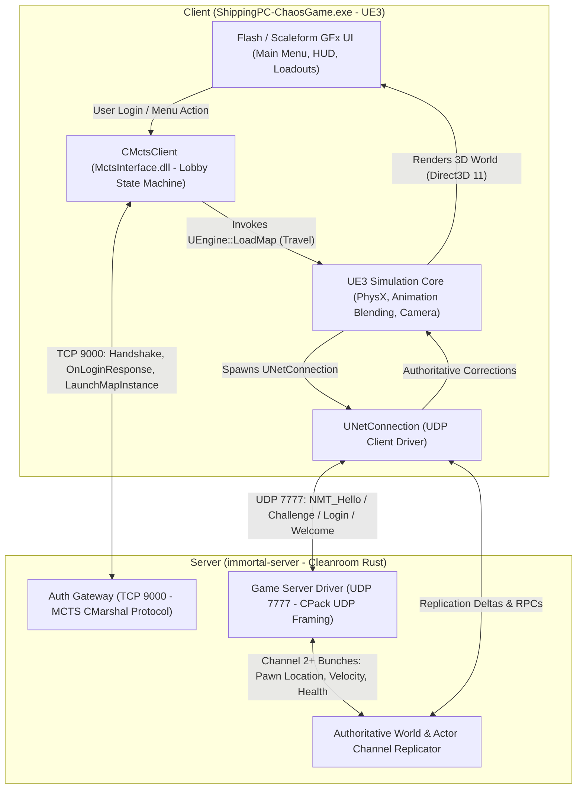
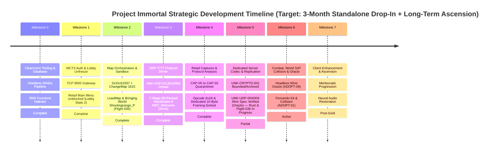

<!-- SPDX-License-Identifier: Apache-2.0 -->
<!-- Copyright (c) 2026 Project Immortal Contributors -->
<!-- Governed by: Cleanroom Preservation Standard & Community IP Framework -->

# Project Immortal: Living Engineering Roadmap 🗺️🛡️

> *"I will not die, not yet, amigo!"* — Fernando (*Project Immortal*)

**Document Standard**: `SPEC-2026-IMMORTAL-ROADMAP-001`  
**Governing ADRs**: ADR-012 (Artifact-First Planning), ADR-014 (Product vs Project Bifurcation), ADR-015 (Clean-Room Verification), ADR-028 (Cleanroom Reconstruction)  
**Target Client**: *Paladins: Champions of the Realm* (UE3 64-bit `ShippingPC-ChaosGame.exe`, version `8.1.5839.0`)  
**Core Server Binary**: `crates/immortal-server` (Cleanroom Rust implementation on TCP 9000 & UDP 7777)

---

## 1. Executive Summary & Cleanroom Shield

Project Immortal is an independent, cleanroom game preservation suite and high-performance dedicated server emulator for *Paladins: Champions of the Realm*. The project decouples the unmaintained retail client from proprietary backend dependencies, ensuring long-term preservation, community hosting, and verifiable protocol determinism.

### The Cleanroom Boundary Invariant (INV-007)
All reverse engineering occurs in an isolated **Dirty Room** (`/mnt/fast_data/re_dirtyroom`), using automated Ghidra decompilation, REA inspection, and binary indexing (`scripts/dirtyroom/dirty`). Zero proprietary game binaries, decompiled C++ snippets, or vendor assets are ever committed or tracked in the cleanroom repository. All server components are authored cleanly in Rust from typed specifications and validated via automated test gates (`cargo test --all`).

---

## 2. End-to-End Game Loop Architecture

The following macro topology defines the division of responsibility between the retail UE3 client and the cleanroom Rust server stack:

### Responsibility Matrix: Client vs. Server
| Domain | Client Responsibility | Server Responsibility (Cleanroom Authority) |
| :--- | :--- | :--- |
| **Presentation & UI** | Direct3D 11 rendering, Scaleform GFx menus, HUD, particle VFX, Vivox/Wwise audio. | Zero rendering. Pure protocol state machines and typed serialization. |
| **Input & Prediction** | Client-side input sampling (WASD/Mouse), immediate predictive motion, camera pitch/yaw. | Input validation, speed/bounds checking, authoritative position sync $(X, Y, Z)$. |
| **Lobby & Auth** | Manages Lobby States (`1 -> 2`); renders profile, champion masteries, and card loadouts. | Validates tickets on TCP 9000; transmits `OnLoginResponse`, inventory rowsets, and match tickets. |
| **Transport** | UE3 `UNetConnection` socket on UDP 7777; packs bunches and ACKs. | `CPack` framing, HMAC-SHA256 handshake verification, connection state tracking. |
| **World Simulation** | Local PhysX terrain collision, animation interpolation, ragdolls, sound dispatch. | Ultimate world authority: actor channels (Ch 2+), hitboxes, damage, cooldowns, projectile paths. |

---

## 3. Strategic Milestones & Chronological Timeline

---

### Detailed Milestone Breakdown

#### Milestone 0: Cleanroom Tooling & Binary Intelligence ⚙️
- **Status**: **COMPLETE (Certified)**
- **Objectives**: Establish legal cleanroom barrier, index game symbols, and build non-invasive reverse engineering pipelines.
- **Key Deliverables**:
  - `scripts/dirtyroom/dirty`: Headless Ghidra decompilation, native `objdump` disassembler, SQLite indexer.
  - SQLite Database (`symbols/paladins_symbols.sqlite`): 356,819 functions, 817,179 strings, 848 RTTI classes indexed.
  - PCAP analysis tooling with non-interactive TShark extraction.
  - `CLEANROOM_LEDGER.md` & `DIRTYROOM_GUIDE.md` formal specifications.

#### Milestone 1: MCTS Authentication & Lobby Unfreeze 🔓
- **Status**: **COMPLETE (Verified on Live Retail Client)**
- **Objectives**: Emulate Hi-Rez MCTS TCP 9000 gateway to unfreeze the live retail client from the initial login screen into the 3D Main Menu.
- **Key Deliverables**:
  - `crates/immortal-net/src/gateway.rs`: Asynchronous Tokio TCP listener on port 9000.
  - `crates/immortal-net/src/mcts_handshake.rs`: Authentic binary `CMarshalRow` encoder for `PLAYER_SVC_USER_LOGIN_RESPONSE` (`0x7a4036ab`).
  - Champion roster unlocking (Fernando, Cassie, Viktor) and weapon device inventories.
  - **Live Verification**: Retail client successfully logs in and renders the full interactive 3D Main Menu (`LobbyMapV4_P` in Direct3D 11 under GE-Proton9-15) with active "PLAY" button and unlocked champions.

#### Milestone 2: Map Instance Orchestration & Sandbox Travel 🏝️
- **Status**: **COMPLETE (Verified on Live Retail Client in Flight 035)**
- **Objectives**: Direct the live retail client from Lobby State 2 / Gazebo into the Shooting Range sandbox (`Shootingrange_P`) on UDP 7777.
- **Key Deliverables**:
  - `MAP_INSTANCE_ASSIGNED` (`0x15c61937` with Table `1583`, Token `2287`, Token `588`, Token `682 = 1615`, Token `685`), `LaunchMapInstance` (`0x4bee2ed8`), and `ChangeMap` (`0x847de68b`).
  - Post-login `0x07FE` (`2046`-byte) zero-length chunk framing in `crates/immortal-net/src/gateway.rs`.
  - **Flight 035 Verification (`7a15b5d`)**: Verified `LOBBY_MENU (+30.62s)` -> `GAZEBO (+35.22s)` -> `ReceiveChangeMap: mapGameId 1615` -> `Welcomed by server (Level: Shootingrange_P, Game: TgGame.TgGame_Paladins_ShootingRange)` -> `LoadMap: 0.0.0.0:7777/Shootingrange_P?...` -> `Bringing World shootingrange_p.TheWorld up for play (1143)` (`38.93s`, exit `0`, zero `NetComeGo: Close`).

#### Milestone 3: UDP 7777 Protocol Handshake & Connection Driver 📡
- **Status**: **COMPLETE (Verified in Flight 035 — `UNK-UDP-001`, `UNK-UDP-002`, `UNK-UDP-005` Closed)**
- **Objectives**: Establish cleanroom UE3 bit-packed network connection driver handling the complete Paladins UDP 7777 Control Channel handshake.
- **Key Deliverables**:
  - `crates/immortal-net/src/bitstream.rs`: Cleanroom LSB-first `BitReader`/`BitWriter` (`u64`-safe `SerializeInt`/`WriteIntWrapped` across `MAX_PACKET_BITS = 4608` 13b/12b boundaries, stop-bit framing, `FString`, and signed `i32` `%d` `ue3_handshake_crc` over UTF-16LE `0x04C11DB7`).
  - `crates/immortal-net/src/bunch.rs`: Authentic `Ue3Packet`, `Bunch`, `Ue3ChannelType` (`1..=5`), `NMT_*` (`0x00..=0x20`), and 7-stage `ControlChannelHandshake` (`0x1A -> 0x1B -> 0x1C -> 0x1D -> 0x20 -> 0x1F(0) -> 0x00 -> 0x03 -> 0x04/0x05 -> 0x01 -> 0x09`).
  - `crates/immortal-server/src/game_server.rs`: Packet-atomic staged handshake driver with 10-bit modular `in_reliable_ctrl` ordering, ACK piggybacking, pure-ACK storm suppression, bounded session table (`MAX_SESSIONS = 1024`), and Flight 034 golden loopback integration tests (`cargo test --workspace` passing).
  - **Flight 035 Live Verification**: Entire 7-stage handshake completed in `24 ms` (`06:28:37.192Z -> .216Z`) with exact `appStrCrc` match (`3997711111`), 159-byte 12-bit `NMT_Login` decode, and bare `NMT_Welcome`.
  - **Carry-Forward Discovery to M4**: Post-`Bringing World`, the client emits Control Channel opcode `0x2A` prior to/alongside `NMT_Join`; visual 3D Shooting Range rendering awaits `0x2A` + `NMT_Join` + `UNK-UDP-004` (`UActorChannel` `PlayerController`/Pawn camera spawn) + post-`Bringing World` render settle in `flight.py`.

#### Milestone 4: Retail Capture Preservation & Protocol Forensics 🛡️
- **Status**: **COMPLETE (Verified against CAP-00 through CAP-03)**
- **Objectives**: Preserve live retail dedicated-server UDP & MCTS captures, isolate network traces via cgroup `nflog:42`, solve Opcode `0x2A` (`NMT_MapLoaded`), and prove the 10-byte framing protocol.
- **Key Deliverables**:
  - **Retail Preservation Captures Quarantined**: `CAP-00` (Shooting Range), `CAP-01` (Bot Siege on Celestial Fortress), and `CAP-03` (Custom 1v1 Baseline on Jaguar Falls) captured cleanly without host data leak.
  - **Opcode `0x2A` (`NMT_MapLoaded`) & Transport Forensics**: Formally documented in [`docs/reports/FLIGHT036_STATIC_RECONNAISSANCE_REPORT.md`](../reports/FLIGHT036_STATIC_RECONNAISSANCE_REPORT.md) and [`docs/reports/CAP03_FRAMING_INVESTIGATION_REPORT.md`](../reports/CAP03_FRAMING_INVESTIGATION_REPORT.md).
  - **Dedicated Server 10-Byte Outer Framing**: Proved Layer A (unsequenced `0x0010` handshake & PMTU) and Layer B (sequenced `0x0001` outer header; the earlier Seq 1 6-byte session token barrier claim was retracted under `PSL-INV-012` / `#42` after proving TX/RX Salsa20 keystream reuse over 6 zero bytes of `PComNetConn`).

#### Milestone 5: Dedicated-Server Codec Convergence & Actor Replication ⚔️
- **Status**: **IN PROGRESS — Wire Spec Verified Bit-Exact Against Retail Oracle (`ch=3,4,5,12,13,80,81`); Rust Integration & Live Flight 036 In Progress** *(`UNK-CRYPTO-001` Mathematically Bounded / Archived)*
- **Objectives**: Extend UE3 bitstream codec with bit-exact `UActorChannel`, `UPackageMap`, and `FClassNetCache` serialization (`UACTOR_CHANNEL_WIRE_SPEC.md`), replace simulated actor replication in `crates/immortal-server`, and verify live 3D Shooting Range spawn in Flight 036.
- **Key Deliverables**:
  - **Cleanroom Wire Specification (`UACTOR_CHANNEL_WIRE_SPEC.md`)**: Published [`docs/specs/UACTOR_CHANNEL_WIRE_SPEC.md`](UACTOR_CHANNEL_WIRE_SPEC.md). **`UNK-UDP-003` & `UNK-UDP-004` are Wire Spec Verified Bit-Exact Against Retail Oracle (`ch=3,4,5,12,13,80,81`, `0` leftover bits)** via `?exudp=0` (`ADOPT-09`); Rust integration (`crates/immortal-extract`, `crates/immortal-net`, `crates/immortal-server`) and Live Flight 036 verification remain in progress (kept open until Flight 036 succeeds).
  - **`UNK-CRYPTO-001` Mathematically Bounded / Archived (`#42`)**: Static RE (`ShippingPC-ChaosGame.exe`) proved `?exudp=2` (`CPackUdp`) uses RFC 5114 2048-bit ephemeral DH + identical TX/RX `Salsa20` + 16B `AES-MAC` (`CAP-03` Frame 14612 XOR Frame 14613 = `000000000000...`, retracting the false Seq 1 session token barrier claim). Offline decryption of `CAP-01`/`CAP-03` is mathematically impossible; superseded by plaintext `?exudp=0` + `ADOPT-09` local Retail Oracle.
  - **Simulated Actor Replication Prototype**: `crates/immortal-server/src/replication.rs` remains a simulated byte-aligned prototype (`REP_OP_*`) until Rust `FClassNetCache` / `UActorChannel` integration lands and passes Flight 036.
  - **Obligation Ledger Realignment (`PSL-INV-012`)**: Updated [`docs/specs/CLEANROOM_LEDGER.md`](CLEANROOM_LEDGER.md) (`OBL-UDP-003` / `OBL-UDP-004` Wire Spec Verified Against Retail Oracle, Rust & Flight 036 In Progress; `UNK-CRYPTO-001` Mathematically Bounded / Archived; `OBL-PROP-001` unblocked via `?exudp=0` Oracle).
  - **Tempest Architectural Exploration**: Quarantined `LowRezStudio/Tempest` (GPL-3.0) and authored [`docs/reports/TEMPEST_COMPARATIVE_ARCHITECTURAL_REPORT.md`](../reports/TEMPEST_COMPARATIVE_ARCHITECTURAL_REPORT.md) and [`docs/specs/TEMPEST_ADOPTION_LEDGER.md`](TEMPEST_ADOPTION_LEDGER.md) with 12 adoption specifications (`ADOPT-01` to `ADOPT-12`).
  - **Rule Enforcement**: Codified `PSL-INV-012` (Anti-Guess, Absolute Truth & Zero-Facade Invariant) in `AGENTS.md`.

#### Milestone 6: Combat Authority, World SAT Collision & Retail Oracle 🏆
- **Status**: **ACTIVE (Current Milestone — Target: Month 2.5–3)**
- **Objectives**: Implement authoritative combat mechanics for Fernando, extract pure-Rust SAT collision from UPK levels (`ADOPT-01`), deploy the Headless Wine Retail Dedicated Server Oracle (`ADOPT-09`), and implement dual-stage hitboxes (`ADOPT-02`, `ADOPT-03`).
- **Landed M6 Foundations**:
  - **ADOPT-09: Headless Wine Dedicated Server Oracle**: `scripts/dirtyroom/patch_server_binary.py` (`SEEKFREE_OFFSET = 0xD19C23`, `HOOK_OFFSET = 0xD1A9DF`, `CAVE_OFFSET = 0x24628A0` setting `GRHIShaderPlatform = 3` and calling `CTgAssemblyManager::LoadFile`, `DYNAMIC_BASE = 0`) + `.agents/commands/oracle.py` (`unset DISPLAY`, isolated `.dirtyroom/oracle/runtime/Binaries/Win64/ShippingPC-ChaosGame-Server.exe`). Verified live via `agyis oracle test` (`6/6` milestones, UDP `127.0.0.1:7000` bound in `13.5s` on `SG_JaguarFalls_Rework_P` and `14.5s` on `Shootingrange_P`; `pytest .agents/commands/tests/`: `58 passed`).
  - **ADOPT-01: Server Physical World Collision Extractor**: Fixed `ObjectExport` `TArray<i32>` `generation_net_object_count` desync (`0` `UnknownExport_` across `FERNANDO_ASSETS_SF.upk`, `DEVICE10774_ASSETS_SF.upk`, `Shootingrange_Collision.upk`, `SG_JaguarFalls_Rework_P.upk`, `SG_StoneKeep_P.upk`), implemented `FPropertyTag` deserialization in `crates/immortal-extract/src/property.rs`, and implemented `UBrushComponent` / `URB_BodySetup` `ConvexHull` + pure-Rust SAT `raycast` / `sphere_sweep` / `contains_point` in `crates/immortal-extract/src/collision.rs` (`413` convex hulls across 6 real UPKs pass `validate_closure(0.1)`; `45` unit + `12` integration tests pass).
  - **ADOPT-02 / ADOPT-03: Dual-Stage Hitboxes & Rooftop/Heavy-Wall Physics**: Implemented `crates/immortal-server/src/combat.rs` (`CylinderHitbox`, `HeadHitbox` `b_head`, `normalize_head_to_cylinder`, Fernando Flame Lance cone, 4000 HP `ShieldBarrier`, Fireball, Charge, Immortal aura clamp) and `crates/immortal-server/src/physics.rs` (`SurfaceInteraction`, `STEEP_SURFACE_COS_45`, `m_bCanBaseOn` heavy-wall invariant), exported from `immortal-server` (`33` lib + `1` bin + `3` integration tests pass).
- **Remaining M6 & G4 Targets**:
  - **Server Simulation Wiring**: Integrate `collision.rs`, `combat.rs`, and `physics.rs` into the live `game_server.rs` tick loop once `UNK-UDP-004` (`UActorChannel` Rust codec integration & Live Flight 036) completes.
  - **ADOPT-04: Havok AI 2016.1 NavMesh & $A^*$**: Parse `TAG0` from `Shootingrange_P.upk` / `SG_JaguarFalls_Rework_P.upk` / `SG_StoneKeep_P.upk` (`crates/immortal-extract/src/navmesh.rs`) and add bot pathfinding (`crates/immortal-server/src/ai.rs`).
  - **G4/M6 Metadata Cross-Reference (`https://paladinscat.com`)**: Use [`https://paladinscat.com`](https://paladinscat.com) as the primary community reference for updated Paladins champion, card, item, and balance data during G4 catalog construction and M6 gameplay tuning. Under `PSL-INV-012`, **local UPK and Retail Oracle (`ADOPT-09`) binary ground truth remains authoritative** whenever community documentation diverges from the shipped `8.1.5839.0` assets or server behavior.

#### Milestone 7: Client Enhancement, Meritocratic Progression & Eternal Preservation 🌟
- **Status**: **LONG-TERM VISION (Post-Drop-in Server / Ascension Phase)**
- **Objectives**: Elevate Project Immortal beyond dedicated server preservation into an enhanced, completely de-monetized, community-governed master edition of *Paladins: Champions of the Realm*.
- **Key Deliverables**:
  - **7.1 100% De-Monetized Meritocratic Progression Architecture**:
    - **Liberation from Predatory Microtransactions**: Complete eradication of loot chests, battle passes, crystal currencies, and FOMO monetization models.
    - **100% Cosmetic Catalog Availability**: All 60+ champions, hundreds of skins (Obsidian, Cosmic, Mastery, Event, and Crossover variants), weapon models, mounts, announcer packs, sprays, avatars, loading frames, and titles are unlockable exclusively through in-game gameplay, champion mastery tiers (Levels 1–100+), account prestige, and skill achievements.
    - **Cleanroom MCTS Inventory Emulation**: Cleanroom emulation of MCTS inventory tokens (`PLAYER_SVC_USER_LOGIN_RESPONSE`, `INVENTORY_ROWSET`, `0x7a4036ab`) driven by a local SQLite progression profile. The client natively unlocks and displays equipment without client binary patching.
  - **7.2 Neural Audio Restoration & Missing Voice Line Synthesis**:
    - **The Legacy Audio Void**: Retail client execution reveals persistent `AkAudioDevice` warning logs (`AkEvent: Knight_TR_BehindUs_Play failed to post`) where older champion skins and legacy voice packs lack audio assets for newer VGS commands (e.g. `[VB*]` series: *"Enemies behind us!"*), directed death/taunt reactions, or contextual map pings.
    - **Zero-Shot / Few-Shot Neural Voice Pipeline**: Utilizing cleanroom-extracted Wwise acoustic datasets (`.wem` / `.bnk` in UPKs) as authentic voice models, generate the missing voice lines matching the exact timbre, resonance, accent, and dramatic cadence of the original voice actors (e.g., Fernando, Cassie, Evie, Mal'Damba).
    - **Non-Invasive SoundBank Injection**: Package synthesized lines into cleanroom drop-in Wwise SoundBanks (`.bnk` / `.pck`) without touching game executables, delivering 100% complete voice coverage for every champion skin and announcer in the game.
  - **7.3 `CAP-04` Unencrypted Oracle Blind-Test Matrix**:
    - Formal ground-truth validation benchmark using unencrypted `?exudp=0` captures from the local headless Wine Retail Oracle (`ADOPT-09`, superseding encrypted `?exudp=2` `CAP-03` payloads archived under `UNK-CRYPTO-001`):
      - **Blind Test 1 (Fernando Talent Identification)**: Cleanroom `ActorBunchCodec` must deterministically identify the selected Talent from unencrypted `UActorChannel` replication bunches.
      - **Blind Test 2 (In-Match Economy & Item Upgrades)**: Exact deduction of item purchases (`ServerPurchaseItem`) and credit costs from unencrypted replication bunches and RPCs (`OBL-PROP-001`).
      - **Blind Test 3 (Custom Room Parameters & Passwords)**: Deterministic extraction of custom match configuration parameters from MCTS TCP `MLS_CustomLobby` payloads (room password, spectator password, draft style, bot difficulty, region routing).
  - **7.4 Community Sovereignty & Custom Content**:
    - Native offline play support and LAN peer discovery.
    - Community server hosting with custom balance patch definitions, mutator presets, and map rotation governance.
    - Built-in replay streaming and match analysis integration.

---

## 4. Technical Roadblocks & De-risking Matrix

Cross-referenced with [`docs/specs/TECHNICAL_ROADBLOCKS.md`](TECHNICAL_ROADBLOCKS.md):

| Risk ID | Technical Challenge | Likelihood | Impact | Concrete De-risking Strategy |
| :--- | :--- | :---: | :---: | :--- |
| **RB-01** | Cryptographic Session Validation | Low | High | **Resolved**: Handshake bypass verified; session tickets validated locally via HMAC-SHA256. |
| **RB-02** | MCTS Packet Framing & Desync | Medium | High | **Resolved**: Header size checks and uncompressed CMarshal row parsing implemented. |
| **RB-03** | Actor Bunch Bitstream Packing | High | Critical | Synthetic bitstream conformance suite (`crates/immortal-net/tests/conformance_replay_test.rs`). |
| **RB-04** | Scaleform UI Travel Callbacks | Medium | Medium | Automated UI event probing and MCTS dispatch simulation in dirtyroom. |
| **RB-05** | Movement Jitter & Latency Desync | High | Medium | Standard client prediction with server error-decay smoothing and snapshot interpolation. |
| **RB-06** | UPK Skeletal Mesh / Texture Format | Medium | Medium | **Open / Partial**: UPK headers/chunks, `FPropertyTag` (`property.rs`), `UBrushComponent`/`URB_BodySetup` SAT collision (`collision.rs`), and glTF 2.0 writer exist, but real UE3 `USkeletalMesh` (`FStaticLODModel`) and `UTexture2D` UPK payload parsing remain incomplete. |

---

## 5. Living Governance & Verification Standard

Every milestone and pull request must satisfy the project's **Universal Automated Verification Standard** before landing:
1. **Automated Verification Contract (INV-001)**: `cargo test --all` (and `cargo test --workspace --verbose`) must exit 0.
2. **Formatting & Linter Hygiene**: `cargo fmt --all -- --check` and `cargo clippy --workspace --all-targets -- -D warnings` must succeed with zero diagnostics.
3. **Documentation Sync**: `mdbook build docs` must succeed without broken includes or broken local hrefs.
4. **End-to-End Flight & Cleanroom Dual-Auditor Gate (INV-008)**: Automated flight validation (`agyis flight --target range --timeout 120`), `agyis verify --spec`, `agyis audit aff`, and independent verification by `agyis_reviewer` and `agyis_auditor` prior to release.
