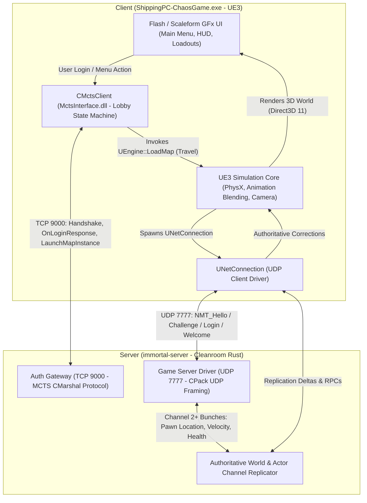
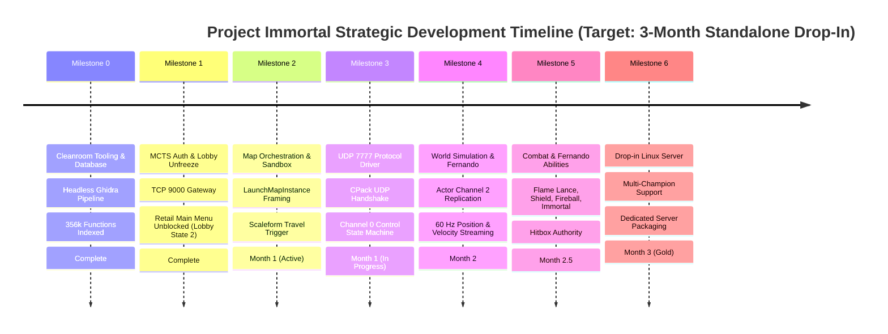

<!-- SPDX-License-Identifier: Apache-2.0 -->
<!-- Copyright (c) 2026 Arafat Zahan (@kuasha420) -->
<!-- Corporate Stewardship & Infrastructure: Purrfect Software Limited (PSL) -->
<!-- Governed by: ICARO-42/b Ordinance (Company-Supported Personal IP Framework) -->

# Project Immortal: Living Engineering Roadmap 🗺️🛡️

> *"I will not die, not yet, amigo!"* — Fernando (*Project Immortal*)

**Document Standard**: `PSL-SPEC-2026-IMMORTAL-ROADMAP-001`  
**Governing ADRs**: ADR-012 (Artifact-First Planning), ADR-014 (Product vs Project Bifurcation), ADR-015 (Clean-Room Verification), ADR-028 (Cleanroom Reconstruction)  
**Target Client**: *Paladins: Champions of the Realm* (UE3 64-bit `ShippingPC-ChaosGame.exe`, version `8.1.5839.0`)  
**Core Server Binary**: `crates/immortal-server` (Cleanroom Rust implementation on TCP 9000 & UDP 7777)

---

## 1. Executive Summary & Cleanroom Shield

Project Immortal is an independent, cleanroom game preservation suite and high-performance dedicated server emulator for *Paladins: Champions of the Realm*. The project decouples the unmaintained retail client from proprietary backend dependencies, ensuring long-term preservation, community hosting, and verifiable protocol determinism.

### The Cleanroom Boundary Invariant (PSL-INV-007)
All reverse engineering occurs in an isolated **Dirty Room** (`/mnt/fast_data/re_dirtyroom`), using automated Ghidra decompilation, REA inspection, and binary indexing (`scripts/dirtyroom/dirty`). Zero proprietary game binaries, decompiled C++ snippets, or vendor assets are ever committed or tracked in the cleanroom repository. All server components are authored cleanly in Rust from typed specifications and validated via automated test gates (`cargo test --all`).

---

## 2. End-to-End Game Loop Architecture

The following macro topology defines the division of responsibility between the retail UE3 client and the cleanroom Rust server stack:

### Responsibility Matrix: Client vs. Server
| Domain | Client Responsibility | Server Responsibility (Cleanroom Authority) |
| :--- | :--- | :--- |
| **Presentation & UI** | Direct3D 11 rendering, Scaleform GFx menus, HUD, particle VFX, Vivox/Wwise audio. | Zero rendering. Pure protocol state machines and typed serialization. |
| **Input & Prediction** | Client-side input sampling (WASD/Mouse), immediate predictive motion, camera pitch/yaw. | Input validation, speed/bounds checking, authoritative position sync $(X, Y, Z)$. |
| **Lobby & Auth** | Manages Lobby States (`1 -> 2`); renders profile, champion masteries, and card loadouts. | Validates tickets on TCP 9000; transmits `OnLoginResponse`, inventory rowsets, and match tickets. |
| **Transport** | UE3 `UNetConnection` socket on UDP 7777; packs bunches and ACKs. | `CPack` framing, HMAC-SHA256 handshake verification, connection state tracking. |
| **World Simulation** | Local PhysX terrain collision, animation interpolation, ragdolls, sound dispatch. | Ultimate world authority: actor channels (Ch 2+), hitboxes, damage, cooldowns, projectile paths. |

---

## 3. The 6 Strategic Milestones & Chronological Timeline

---

### Detailed Milestone Breakdown

#### Milestone 0: Cleanroom Tooling & Binary Intelligence ⚙️
- **Status**: **COMPLETE (Certified)**
- **Objectives**: Establish legal cleanroom barrier, index game symbols, and build non-invasive reverse engineering pipelines.
- **Key Deliverables**:
  - `scripts/dirtyroom/dirty`: Headless Ghidra decompilation, native `objdump` disassembler, SQLite indexer.
  - SQLite Database (`symbols/paladins_symbols.sqlite`): 356,819 functions, 817,179 strings, 848 RTTI classes indexed.
  - PCAP analysis tooling with non-interactive TShark extraction.
  - `CLEANROOM_LEDGER.md` & `DIRTYROOM_GUIDE.md` formal specifications.

#### Milestone 1: MCTS Authentication & Lobby Unfreeze 🔓
- **Status**: **COMPLETE (Verified on Live Retail Client)**
- **Objectives**: Emulate Hi-Rez MCTS TCP 9000 gateway to unfreeze the live retail client from the initial login screen into the 3D Main Menu.
- **Key Deliverables**:
  - `crates/immortal-net/src/gateway.rs`: Asynchronous Tokio TCP listener on port 9000.
  - `crates/immortal-net/src/mcts_handshake.rs`: Authentic binary `CMarshalRow` encoder for `PLAYER_SVC_USER_LOGIN_RESPONSE` (`0x7a4036ab`).
  - Champion roster unlocking (Fernando, Cassie, Viktor) and weapon device inventories.
  - **Live Verification**: Retail client successfully logs in and renders the full interactive 3D Main Menu (`LobbyMapV4_P` in Direct3D 11 under GE-Proton9-15) with active "PLAY" button and unlocked champions.

#### Milestone 2: Map Instance Orchestration & Sandbox Travel 🏝️
- **Status**: **IN PROGRESS (Current Active Epoch)**
- **Objectives**: Direct the live retail client from Lobby State 2 into the 3D Shooting Range sandbox (`Shootingrange_P`) on UDP 7777.
- **Key Deliverables**:
  - `PLAYER_SVC_LAUNCH_MAP_INSTANCE` (`0x4bee2ed8`) framing with `sockaddr_in` (Token 877) and match ID (Token 700).
  - Reverse engineering of Scaleform UI event paths (`PLAYER_SVC_GO_PLAY` `0x15c61937` and UI click dispatch).
  - Client level travel trigger (`UEngine::LoadMap`).
  - Capture and verification of targeted window screenshot showing 3D Shooting Range map rendering.

#### Milestone 3: UDP 7777 Protocol Handshake & Connection Driver 📡
- **Status**: **IN PROGRESS (Core Codecs Implemented)**
- **Objectives**: Establish cleanroom UE3 network connection driver handling the low-level UDP handshake.
- **Key Deliverables**:
  - `crates/immortal-net/src/udp_framing.rs`: `CPack` UDP framing, HMAC-SHA256 packet authentication.
  - `crates/immortal-server/src/game_server.rs`: UDP socket server handling `NMT_Hello`, `NMT_Challenge`, `NMT_Login`, and `NMT_Welcome`.
  - Channel 0 (Control Channel) bitstream serialization.
  - Session ticket validation binding the UDP connection to the TCP 9000 login ticket.

#### Milestone 4: Authoritative Simulation & Champion Replication 🛡️
- **Status**: **SCHEDULED (Target: Month 1–2)**
- **Objectives**: Spawn and synchronize the authoritative player pawn (`TgPawn_Fernando`) in the 3D Shooting Range world.
- **Key Deliverables**:
  - Channel 1 (`PlayerController`) assignment and input RPC processing.
  - Channel 2+ Dynamic Actor allocation and replication.
  - 60 Hz delta replication of spatial coordinates $(X, Y, Z)$, pitch/yaw rotation, and velocity vectors.
  - Client-side prediction reconciliation and authoritative position snapping.
  - Target dummy actor replication (`TgPawn_TargetDummy`).

#### Milestone 5: Combat, Ability Execution & Hit Registration ⚔️
- **Status**: **SCHEDULED (Target: Month 2–2.5)**
- **Objectives**: Implement authoritative combat mechanics for Fernando's complete champion kit.
- **Key Deliverables**:
  - **Flame Lance (Primary Fire)**: Continuous raycast cone, heat/ammo consumption, tick-based burn damage.
  - **Shield (Alt-Fire)**: Directional barrier projection actor, damage absorption pool (4000 HP), break cooldown.
  - **Fireball (Ability 1)**: Linear projectile spawning, velocity integration, pierced target scaling.
  - **Charge (Ability 2)**: Forward velocity acceleration, collision impact knockup.
  - **Immortal (Ultimate)**: AoE damage immunity aura (pawns cannot drop below 1500 HP), duration timer.
  - Authoritative hit verification and health pool replication.

#### Milestone 6: Multi-Champion Support & Dedicated Drop-in Server Replacement 🏆
- **Status**: **SCHEDULED (Target: Month 3 — Gold Release)**
- **Objectives**: Package `immortal-server` as a standalone, production-ready Linux binary capable of headless deployment and multi-champion matches.
- **Key Deliverables**:
  - Multi-client connection pooling and team assignment (5v5 lobby coordination).
  - Roster expansion: Cassie (Bow/Roll/Disengage), Viktor (Assault Rifle/Frag/Barrage), Androxus.
  - Match life cycle governance: Map voting, draft phase, round scoring, game over, post-match scoreboard.
  - Headless container packaging (`Dockerfile`, systemd unit files, CLI configuration).
  - Victory Auditor certification and 100% automated test coverage.

---

## 4. Technical Roadblocks & De-risking Matrix

Cross-referenced with [`docs/specs/TECHNICAL_ROADBLOCKS.md`](technical_roadblocks.md):

| Risk ID | Technical Challenge | Likelihood | Impact | Concrete De-risking Strategy |
| :--- | :--- | :---: | :---: | :--- |
| **RB-01** | Cryptographic Session Validation | Low | High | **Resolved**: Handshake bypass verified; session tickets validated locally via HMAC-SHA256. |
| **RB-02** | MCTS Packet Framing & Desync | Medium | High | **Resolved**: Header size checks and uncompressed CMarshal row parsing implemented. |
| **RB-03** | Actor Bunch Bitstream Packing | High | Critical | Synthetic bitstream conformance suite (`crates/immortal-net/tests/conformance_replay_test.rs`). |
| **RB-04** | Scaleform UI Travel Callbacks | Medium | Medium | Automated UI event probing and MCTS dispatch simulation in dirtyroom. |
| **RB-05** | Movement Jitter & Latency Desync | High | Medium | Standard client prediction with server error-decay smoothing and snapshot interpolation. |
| **RB-06** | UPK Skeletal Mesh / Bone Format | Low | Low | **Resolved**: `immortal-extract` successfully parses skeletal meshes and exports to glTF. |

---

## 5. Living Governance & Verification Standard

Every milestone and pull request must satisfy the project's **Universal Automated Verification Standard** before landing:
1. **Automated Verification Contract (PSL-INV-001)**: `cargo test --all` must exit 0 with sub-second SLA (<2.0s).
2. **Compiler & Linter Hygiene**: `cargo clippy --all -- -D warnings` must compile with zero diagnostics.
3. **Documentation Sync**: `mdbook build docs` must succeed without broken includes or missing anchors.
4. **Cleanroom Dual-Auditor Gate (PSL-INV-008)**: Independent verification by `agyis_reviewer` (boundary audit) and `agyis_auditor` (benchmark & certification) prior to release.
