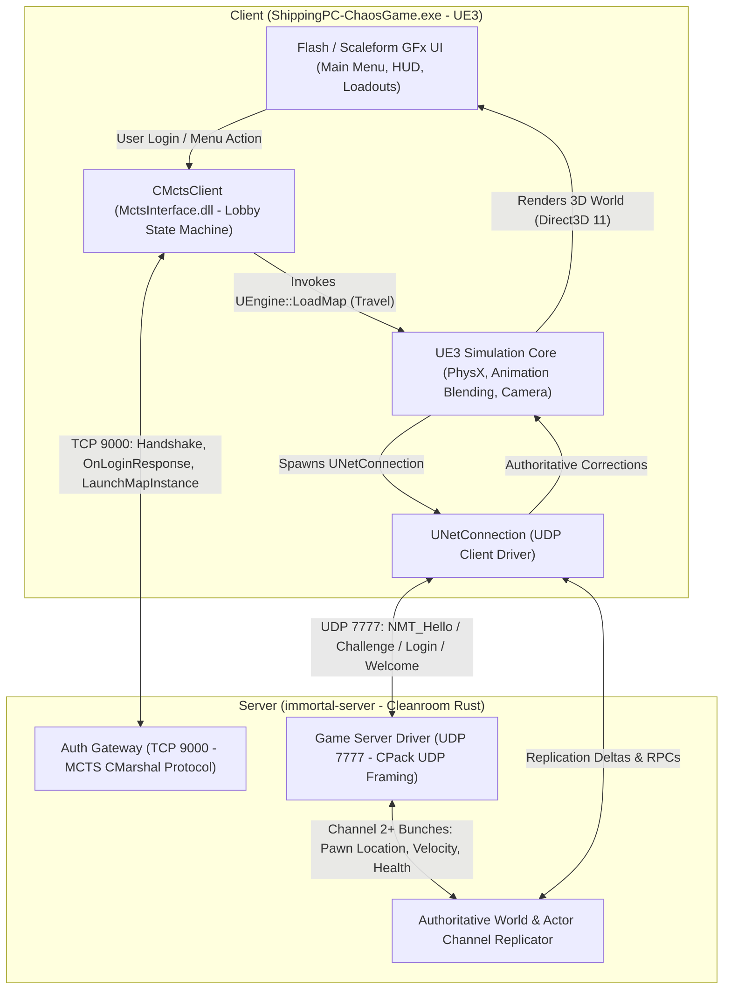
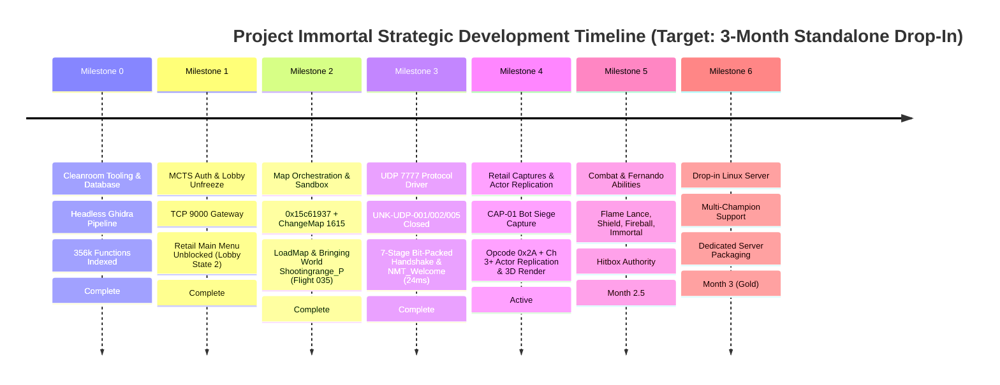

<!-- SPDX-License-Identifier: Apache-2.0 -->
<!-- Copyright (c) 2026 Project Immortal Contributors -->
<!-- Governed by: Cleanroom Preservation Standard & Community IP Framework -->

# Project Immortal: Living Engineering Roadmap 🗺️🛡️

> *"I will not die, not yet, amigo!"* — Fernando (*Project Immortal*)

**Document Standard**: `SPEC-2026-IMMORTAL-ROADMAP-001`  
**Governing ADRs**: ADR-012 (Artifact-First Planning), ADR-014 (Product vs Project Bifurcation), ADR-015 (Clean-Room Verification), ADR-028 (Cleanroom Reconstruction)  
**Target Client**: *Paladins: Champions of the Realm* (UE3 64-bit `ShippingPC-ChaosGame.exe`, version `8.1.5839.0`)  
**Core Server Binary**: `crates/immortal-server` (Cleanroom Rust implementation on TCP 9000 & UDP 7777)

---

## 1. Executive Summary & Cleanroom Shield

Project Immortal is an independent, cleanroom game preservation suite and high-performance dedicated server emulator for *Paladins: Champions of the Realm*. The project decouples the unmaintained retail client from proprietary backend dependencies, ensuring long-term preservation, community hosting, and verifiable protocol determinism.

### The Cleanroom Boundary Invariant (INV-007)
All reverse engineering occurs in an isolated **Dirty Room** (`/mnt/fast_data/re_dirtyroom`), using automated Ghidra decompilation, REA inspection, and binary indexing (`scripts/dirtyroom/dirty`). Zero proprietary game binaries, decompiled C++ snippets, or vendor assets are ever committed or tracked in the cleanroom repository. All server components are authored cleanly in Rust from typed specifications and validated via automated test gates (`cargo test --all`).

---

## 2. End-to-End Game Loop Architecture

The following macro topology defines the division of responsibility between the retail UE3 client and the cleanroom Rust server stack:

### Responsibility Matrix: Client vs. Server
| Domain | Client Responsibility | Server Responsibility (Cleanroom Authority) |
| :--- | :--- | :--- |
| **Presentation & UI** | Direct3D 11 rendering, Scaleform GFx menus, HUD, particle VFX, Vivox/Wwise audio. | Zero rendering. Pure protocol state machines and typed serialization. |
| **Input & Prediction** | Client-side input sampling (WASD/Mouse), immediate predictive motion, camera pitch/yaw. | Input validation, speed/bounds checking, authoritative position sync $(X, Y, Z)$. |
| **Lobby & Auth** | Manages Lobby States (`1 -> 2`); renders profile, champion masteries, and card loadouts. | Validates tickets on TCP 9000; transmits `OnLoginResponse`, inventory rowsets, and match tickets. |
| **Transport** | UE3 `UNetConnection` socket on UDP 7777; packs bunches and ACKs. | `CPack` framing, HMAC-SHA256 handshake verification, connection state tracking. |
| **World Simulation** | Local PhysX terrain collision, animation interpolation, ragdolls, sound dispatch. | Ultimate world authority: actor channels (Ch 2+), hitboxes, damage, cooldowns, projectile paths. |

---

## 3. The 6 Strategic Milestones & Chronological Timeline

---

### Detailed Milestone Breakdown

#### Milestone 0: Cleanroom Tooling & Binary Intelligence ⚙️
- **Status**: **COMPLETE (Certified)**
- **Objectives**: Establish legal cleanroom barrier, index game symbols, and build non-invasive reverse engineering pipelines.
- **Key Deliverables**:
  - `scripts/dirtyroom/dirty`: Headless Ghidra decompilation, native `objdump` disassembler, SQLite indexer.
  - SQLite Database (`symbols/paladins_symbols.sqlite`): 356,819 functions, 817,179 strings, 848 RTTI classes indexed.
  - PCAP analysis tooling with non-interactive TShark extraction.
  - `CLEANROOM_LEDGER.md` & `DIRTYROOM_GUIDE.md` formal specifications.

#### Milestone 1: MCTS Authentication & Lobby Unfreeze 🔓
- **Status**: **COMPLETE (Verified on Live Retail Client)**
- **Objectives**: Emulate Hi-Rez MCTS TCP 9000 gateway to unfreeze the live retail client from the initial login screen into the 3D Main Menu.
- **Key Deliverables**:
  - `crates/immortal-net/src/gateway.rs`: Asynchronous Tokio TCP listener on port 9000.
  - `crates/immortal-net/src/mcts_handshake.rs`: Authentic binary `CMarshalRow` encoder for `PLAYER_SVC_USER_LOGIN_RESPONSE` (`0x7a4036ab`).
  - Champion roster unlocking (Fernando, Cassie, Viktor) and weapon device inventories.
  - **Live Verification**: Retail client successfully logs in and renders the full interactive 3D Main Menu (`LobbyMapV4_P` in Direct3D 11 under GE-Proton9-15) with active "PLAY" button and unlocked champions.

#### Milestone 2: Map Instance Orchestration & Sandbox Travel 🏝️
- **Status**: **COMPLETE (Verified on Live Retail Client in Flight 035)**
- **Objectives**: Direct the live retail client from Lobby State 2 / Gazebo into the Shooting Range sandbox (`Shootingrange_P`) on UDP 7777.
- **Key Deliverables**:
  - `MAP_INSTANCE_ASSIGNED` (`0x15c61937` with Table `1583`, Token `2287`, Token `588`, Token `682 = 1615`, Token `685`), `LaunchMapInstance` (`0x4bee2ed8`), and `ChangeMap` (`0x847de68b`).
  - Post-login `0x07FE` (`2046`-byte) zero-length chunk framing in `crates/immortal-net/src/gateway.rs`.
  - **Flight 035 Verification (`7a15b5d`)**: Verified `LOBBY_MENU (+30.62s)` -> `GAZEBO (+35.22s)` -> `ReceiveChangeMap: mapGameId 1615` -> `Welcomed by server (Level: Shootingrange_P, Game: TgGame.TgGame_Paladins_ShootingRange)` -> `LoadMap: 0.0.0.0:7777/Shootingrange_P?...` -> `Bringing World shootingrange_p.TheWorld up for play (1143)` (`38.93s`, exit `0`, zero `NetComeGo: Close`).

#### Milestone 3: UDP 7777 Protocol Handshake & Connection Driver 📡
- **Status**: **COMPLETE (Verified in Flight 035 — `UNK-UDP-001`, `UNK-UDP-002`, `UNK-UDP-005` Closed)**
- **Objectives**: Establish cleanroom UE3 bit-packed network connection driver handling the complete Paladins UDP 7777 Control Channel handshake.
- **Key Deliverables**:
  - `crates/immortal-net/src/bitstream.rs`: Cleanroom LSB-first `BitReader`/`BitWriter` (`u64`-safe `SerializeInt`/`WriteIntWrapped` across `MAX_PACKET_BITS = 4608` 13b/12b boundaries, stop-bit framing, `FString`, and signed `i32` `%d` `ue3_handshake_crc` over UTF-16LE `0x04C11DB7`).
  - `crates/immortal-net/src/bunch.rs`: Authentic `Ue3Packet`, `Bunch`, `Ue3ChannelType` (`1..=5`), `NMT_*` (`0x00..=0x20`), and 7-stage `ControlChannelHandshake` (`0x1A -> 0x1B -> 0x1C -> 0x1D -> 0x20 -> 0x1F(0) -> 0x00 -> 0x03 -> 0x04/0x05 -> 0x01 -> 0x09`).
  - `crates/immortal-server/src/game_server.rs`: Packet-atomic staged handshake driver with 10-bit modular `in_reliable_ctrl` ordering, ACK piggybacking, pure-ACK storm suppression, bounded session table (`MAX_SESSIONS = 1024`), and Flight 034 golden loopback integration tests (`139 passed, 0 failed`).
  - **Flight 035 Live Verification**: Entire 7-stage handshake completed in `24 ms` (`06:28:37.192Z -> .216Z`) with exact `appStrCrc` match (`3997711111`), 159-byte 12-bit `NMT_Login` decode, and bare `NMT_Welcome`.
  - **Carry-Forward Discovery to M4**: Post-`Bringing World`, the client emits Control Channel opcode `0x2A` prior to/alongside `NMT_Join`; visual 3D Shooting Range rendering awaits `0x2A` + `NMT_Join` + `UNK-UDP-004` (`UActorChannel` `PlayerController`/Pawn camera spawn) + post-`Bringing World` render settle in `flight.py`.

#### Milestone 4: Retail Capture Preservation & Authoritative Champion Replication 🛡️
- **Status**: **ACTIVE (Next Milestone — Target: Month 2)**
- **Objectives**: Preserve live retail dedicated-server UDP & MCTS captures while retail servers remain online, then spawn and synchronize the authoritative player controller & pawn (`TgPawn_Fernando`) in 3D Shooting Range and Bot Matches.
- **Key Deliverables**:
  - **Retail Preservation Capture Sweep**: Execute [`docs/specs/RETAIL_CAPTURE_PLAN.md`](RETAIL_CAPTURE_PLAN.md) (`CAP-01` Training Bot Siege first to unlock real dedicated-server UE3 UDP streams, `0x2A`, `NMT_Uses`, and `UActorChannel` Ch 3+ spawns; followed by `CAP-02`–`CAP-14`).
  - **Post-Load Handshake & Watchdog Hardening**: Disassemble/verify Control opcode `0x2A`, complete `NMT_Join (0x09)` handshake, fix `ensure_immortal_server_built` always-rebuild in `.agents/commands/lib/common.py`, and add post-`Bringing World` render verification to `flight.py`.
  - **Channel 3+ Actor Replication (`UNK-UDP-003` & `UNK-UDP-004`)**: Cleanroom `UActorChannel` (`CHTYPE_Actor = 2`, `ChIndex >= 3`, 1-based `ChSequence`) for `GameReplicationInfo`, `TgPlayerController`, `TgPawn_Fernando`, and 60 Hz delta movement/camera replication.

#### Milestone 5: Combat, Ability Execution & Hit Registration ⚔️
- **Status**: **SCHEDULED (Target: Month 2–2.5)**
- **Objectives**: Implement authoritative combat mechanics for Fernando's complete champion kit.
- **Key Deliverables**:
  - **Flame Lance (Primary Fire)**: Continuous raycast cone, heat/ammo consumption, tick-based burn damage.
  - **Shield (Alt-Fire)**: Directional barrier projection actor, damage absorption pool (4000 HP), break cooldown.
  - **Fireball (Ability 1)**: Linear projectile spawning, velocity integration, pierced target scaling.
  - **Charge (Ability 2)**: Forward velocity acceleration, collision impact knockup.
  - **Immortal (Ultimate)**: AoE damage immunity aura (pawns cannot drop below 1500 HP), duration timer.
  - Authoritative hit verification and health pool replication.

#### Milestone 6: Multi-Champion Support & Dedicated Drop-in Server Replacement 🏆
- **Status**: **SCHEDULED (Target: Month 3 — Gold Release)**
- **Objectives**: Package `immortal-server` as a standalone, production-ready Linux binary capable of headless deployment and multi-champion matches.
- **Key Deliverables**:
  - Multi-client connection pooling and team assignment (5v5 lobby coordination).
  - Roster expansion: Cassie (Bow/Roll/Disengage), Viktor (Assault Rifle/Frag/Barrage), Androxus.
  - Match life cycle governance: Map voting, draft phase, round scoring, game over, post-match scoreboard.
  - Headless container packaging (`Dockerfile`, systemd unit files, CLI configuration).
  - Victory Auditor certification and 100% automated test coverage.

---

## 4. Technical Roadblocks & De-risking Matrix

Cross-referenced with [`docs/specs/TECHNICAL_ROADBLOCKS.md`](technical_roadblocks.md):

| Risk ID | Technical Challenge | Likelihood | Impact | Concrete De-risking Strategy |
| :--- | :--- | :---: | :---: | :--- |
| **RB-01** | Cryptographic Session Validation | Low | High | **Resolved**: Handshake bypass verified; session tickets validated locally via HMAC-SHA256. |
| **RB-02** | MCTS Packet Framing & Desync | Medium | High | **Resolved**: Header size checks and uncompressed CMarshal row parsing implemented. |
| **RB-03** | Actor Bunch Bitstream Packing | High | Critical | Synthetic bitstream conformance suite (`crates/immortal-net/tests/conformance_replay_test.rs`). |
| **RB-04** | Scaleform UI Travel Callbacks | Medium | Medium | Automated UI event probing and MCTS dispatch simulation in dirtyroom. |
| **RB-05** | Movement Jitter & Latency Desync | High | Medium | Standard client prediction with server error-decay smoothing and snapshot interpolation. |
| **RB-06** | UPK Skeletal Mesh / Bone Format | Low | Low | **Resolved**: `immortal-extract` successfully parses skeletal meshes and exports to glTF. |

---

## 5. Living Governance & Verification Standard

Every milestone and pull request must satisfy the project's **Universal Automated Verification Standard** before landing:
1. **Automated Verification Contract (INV-001)**: `cargo test --all` (and `cargo test --workspace --verbose`) must exit 0.
2. **Formatting & Linter Hygiene**: `cargo fmt --all -- --check` and `cargo clippy --workspace --all-targets -- -D warnings` must succeed with zero diagnostics.
3. **Documentation Sync**: `(cd docs && mdbook build && mdbook test)` must succeed without broken includes, untagged fences, or test failures.
4. **End-to-End Flight & Cleanroom Dual-Auditor Gate (INV-008)**: Automated flight validation (`agyis flight --target range --timeout 120`), `agyis verify --spec`, `agyis audit aff`, and independent verification by `agyis_reviewer` and `agyis_auditor` prior to release.
